# FindVP — Find the Viewpoint

**Eye-in-hand viewpoint search in PyBullet and on the Steve UR5e robot.** Give
FindVP a target photograph. It moves the camera around the object, captures
candidate images, compares each one with **DINOv3 + SIFT**, subdivides the best
viewing region, and records the best view it found. On Steve, the arm returns to
that recorded view.

<p align="center">
  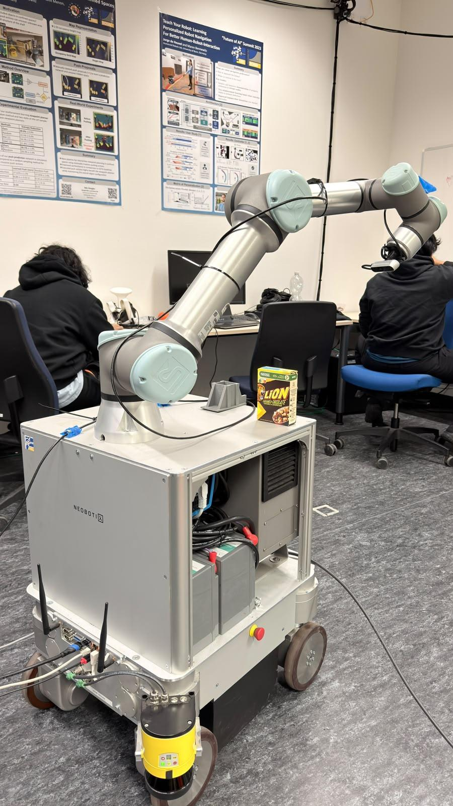
  &nbsp;&nbsp;
  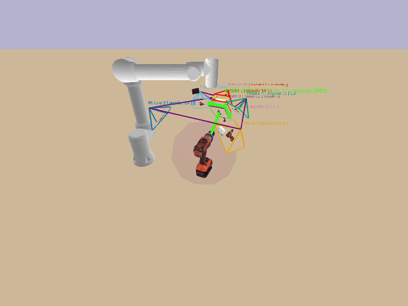
</p>
<p align="center"><sub>Steve in the lab (left) and a simulated camera trajectory (right).</sub></p>

## Start here

| What you want to do | Follow this guide | Runs in |
|---|---|---|
| Try the three-view or full adaptive search | [Simulation quick start](findvp_ss26/README.md#quick-start-simulation) | PyBullet inside `findvp-curobo:0.7.8` |
| Photograph the carton from three viewpoints and return to the winner | [Steve three-view runbook](findvp_ss26/docs/steve_three_view_runbook.md) | ROS 2 dev container + CuRobo planner |
| Continue subdividing the winning triangle and refine camera distance | [Steve active-perception runbook](findvp_ss26/docs/steve_active_perception_runbook.md) | Same real-robot setup |

The current robot programs are in [`findvp_ss26/real_robot/`](findvp_ss26/real_robot/).
They use Steve's live joint states, a CuRobo planner, and the trajectory
controller. A human reviews and approves **every real arm move**. The older
MoveIt adapter and its documentation remain in the repository as reference.

## How the search works

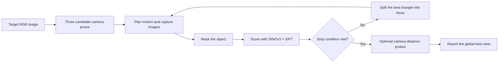

The simulator renders an object and camera in PyBullet. On Steve, the wrist
D415 supplies real RGB images; a measured carton box is projected into each
image to define the mask. The real-robot planner checks candidate paths, and
the operator approves each trajectory before it is sent to the controller.
At the end, the real arm returns to the best captured pose; the simulator
saves the best-view report and returns its arm home.

## What the pipeline produces

### Simulation: target, test view, and selected view

The Power Drill example uses an included target image. The final panel below
comes from an archived adaptive run; a new run can choose a different path or
score because its settings and stopping point may differ.

| Target image | A captured test view | Target beside the selected view |
|:---:|:---:|:---:|
| [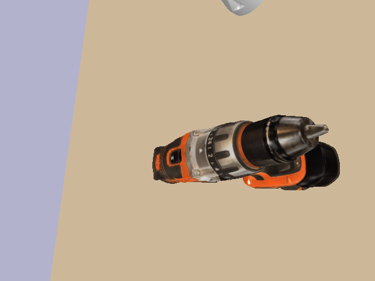](findvp_ss26/assets/examples/drill_target.png) | [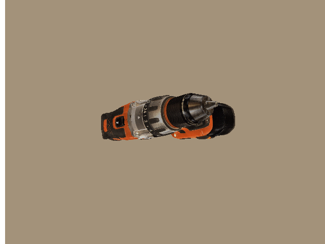](assets/readme/sim_drill_first_view.png) | [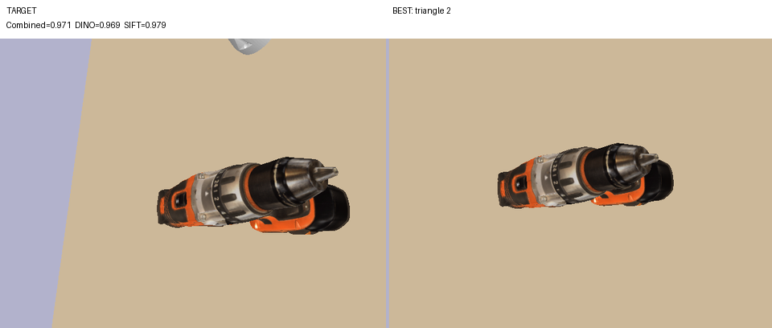](assets/readme/sim_drill_target_best.png) |

The search keeps the best observation across levels. This separate Dog example
shows how the winning region is refined rather than accepting only the first
three views:

[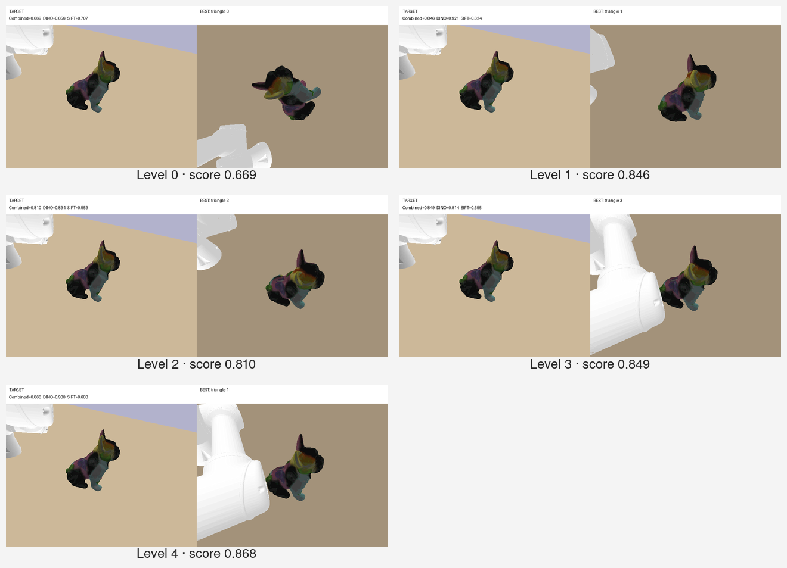](assets/coarse-to-fine-refinement.png)

### Real robot: three views, then active refinement

In the recorded three-view carton run, **T3** was selected and the arm returned
to its captured pose. Green outlines show the object region used for matching:

[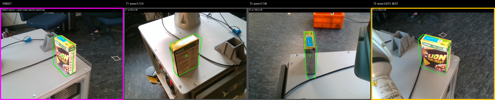](assets/readme/real_three_view_summary.png)

A separate full active-perception run captured **13 images**. It refined the
triangle, tested camera distance, and reached its best recorded view at radial
step **R+2** (similarity **0.968** in that run):

[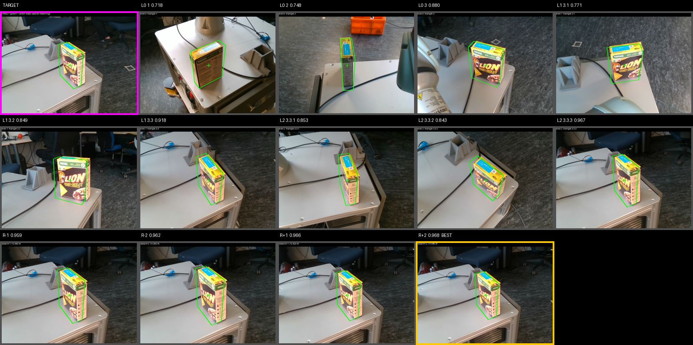](assets/readme/real_active_summary.png)

The target and final winning capture can be inspected at full resolution:

| Target with projected carton outline | Best captured view with outline |
|:---:|:---:|
| [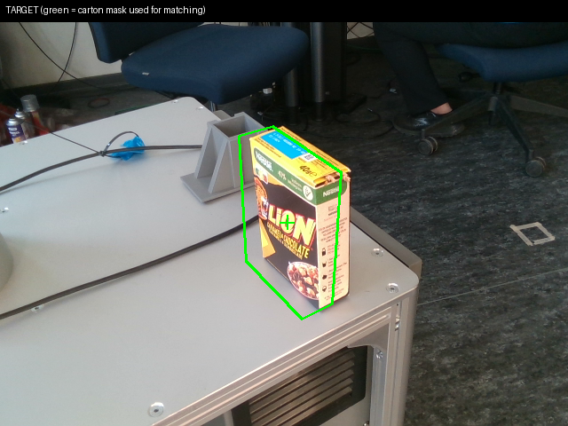](assets/readme/real_target_overlay.png) | [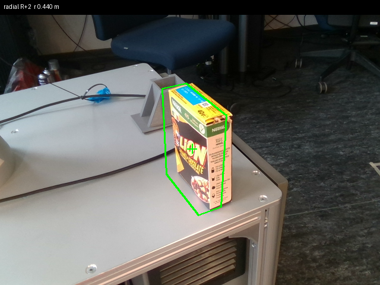](assets/readme/real_best_overlay.png) |

### Why a view scores well

The visualizations below show correspondences between the real target and one
triangle candidate. DINOv3 contributes dense image features; SIFT contributes
local keypoint matches. FindVP combines their evidence when ranking views.

| DINOv3 correspondences | SIFT correspondences |
|:---:|:---:|
| [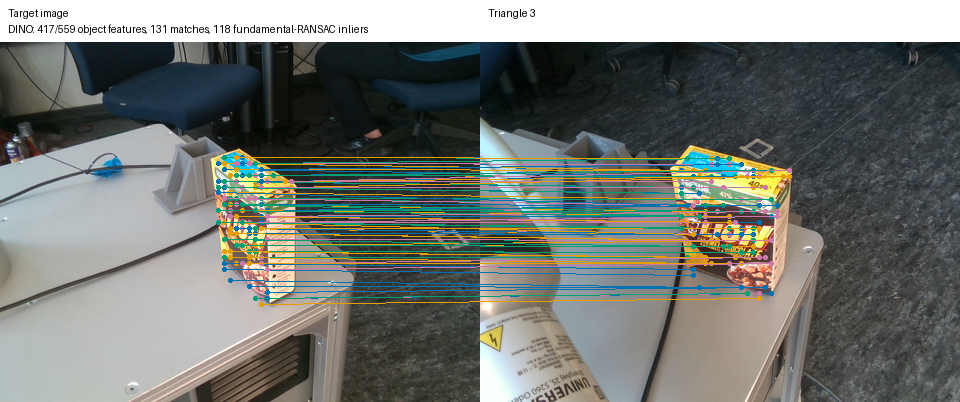](assets/readme/real_dino_matches.png) | [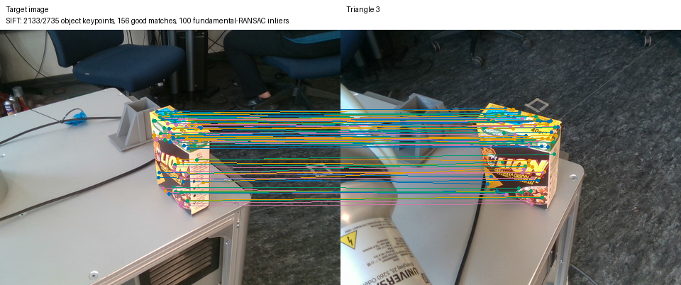](assets/readme/real_sift_matches.png) |

<details>
<summary>Robot planning view and more simulation animations</summary>

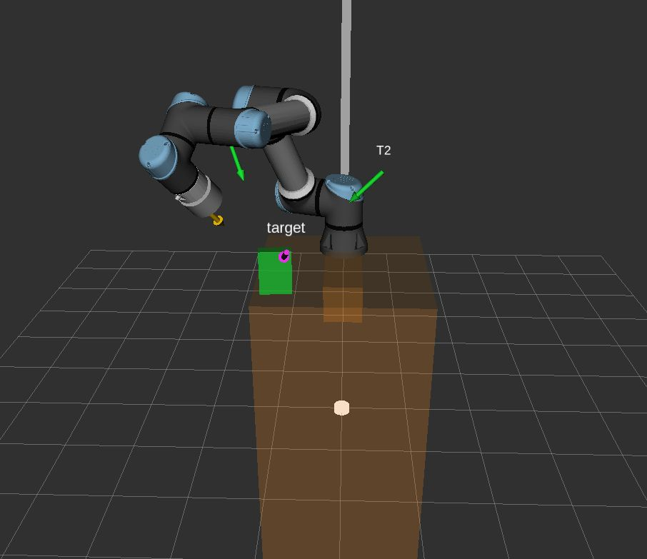

- [Dog camera trajectory GIF](assets/trajectory-visualization.gif)
- [Christmas Bear camera trajectory GIF](assets/beer-trajectory-visualization.gif)

</details>

## Watch the real robot

- [▶ Set the target camera view on Steve (MP4, 2:09)](assets/set_target_realworld.mp4)
- [▶ Supervised viewpoint motion and live visualization (MP4, 4:06)](assets/findvp_reach_target.mp4)

The videos document one lab session. The images above are selected snapshots
from saved runs; the full captured run directories are generated locally and
are not required to run the code.

## One-time setup: CuRobo image

Run this on the **host**, from this workspace's root. Docker first checks for
the local image, then tries the Docker Hub tag, and builds from the included
Dockerfile if the tag is unavailable to your account:

`rafayaamirgull/findvp-curobo:0.7.8` is the Docker Hub pull name.
`findvp-curobo:0.7.8` is the local tag expected by the scripts; `docker tag`
gives a pulled image that local name without copying its contents.

```bash
cd findvp_ss26
if ! docker image inspect findvp-curobo:0.7.8 >/dev/null 2>&1; then
  if docker pull rafayaamirgull/findvp-curobo:0.7.8; then
    docker tag rafayaamirgull/findvp-curobo:0.7.8 findvp-curobo:0.7.8
  else
    docker build -f Dockerfile.curobo-v1 -t findvp-curobo:0.7.8 .
  fi
fi
cd ..
```

Check the image before running either pipeline:

```bash
docker run --rm --entrypoint python3 findvp-curobo:0.7.8 \
  -c 'import pybullet, torch, timm, curobo; print("FindVP image ready")'
```

The local `findvp-curobo:0.7.8` tag is used by both the simulation guide and
`findvp_ss26/real_robot/start_planner.sh`. A GPU is needed for the real-robot
CuRobo planner; the simulation quick start uses PyBullet IK and can run on CPU.

## One-time setup: ROS 2 environment for the real robot

For simulation only, skip this section. For Steve, use an Ubuntu host with
Docker, an NVIDIA GPU, VS Code with Dev Containers, and access to the robot and
wrist D415 camera.

1. Open this workspace folder in VS Code and run **Dev Containers: Rebuild and
   Reopen in Container**. The workspace appears at `/home/ws`. The container
   builds the ROS packages on creation.
2. In a terminal **inside** that container, create the scoring environment:

```bash
cd /home/ws/findvp_ss26
source /opt/ros/humble/setup.bash
python3 -m venv --system-site-packages /home/ws/.venv-findvp
source /home/ws/.venv-findvp/bin/activate
python3 -m pip install torch torchvision --index-url https://download.pytorch.org/whl/cpu
python3 -m pip install -r requirements-ros.txt
python3 -c 'from sample.dinov3_feature_matching import DINOv3FeatureExtractor; DINOv3FeatureExtractor(max_image_size=640); print("DINOv3 ready")'
```

The last command downloads and caches DINOv3 weights; run it with internet
access before the robot session. Then follow the [three-view
runbook](findvp_ss26/docs/steve_three_view_runbook.md) or the [full-search
runbook](findvp_ss26/docs/steve_active_perception_runbook.md) from their first
step. Both include the camera, planner, pendant, scene alignment, motion
preview, execution, and result checks.

## Files kept outside source control

This source tree includes `handeye_result.json`, the configured
`findvp_ss26/real_robot/scene.json`, robot and object assets, two simulation
target images, and curated [README media](assets/readme/README.md). It excludes
virtual environments, ROS build outputs, full captured robot runs, generated
PyBullet output, and the friend's reference repository. New captures go under
`findvp_runs/` or `findvp_ss26/output/` and are ignored by Git.
