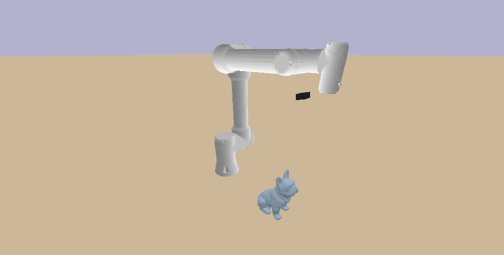
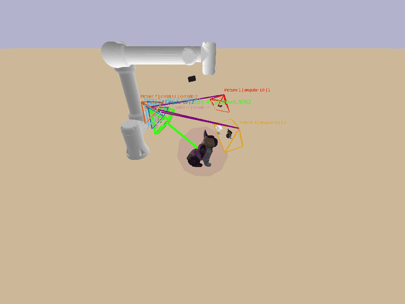
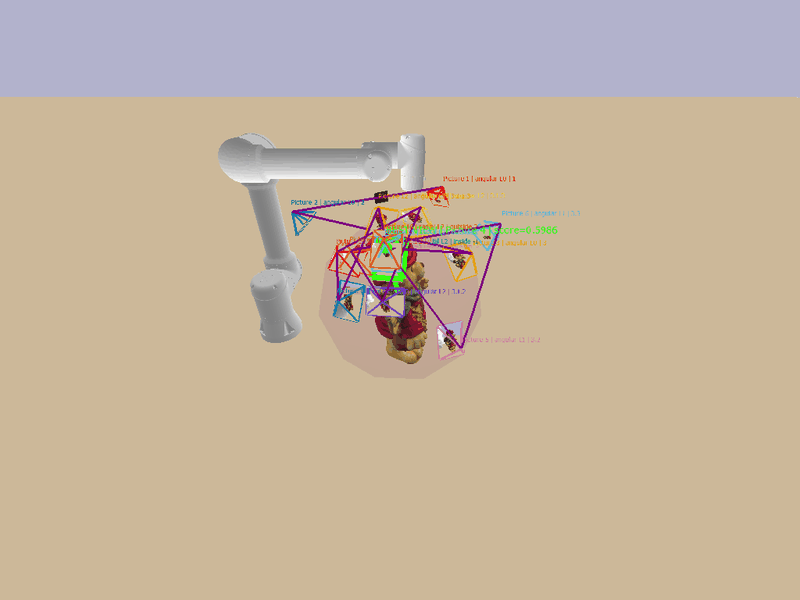
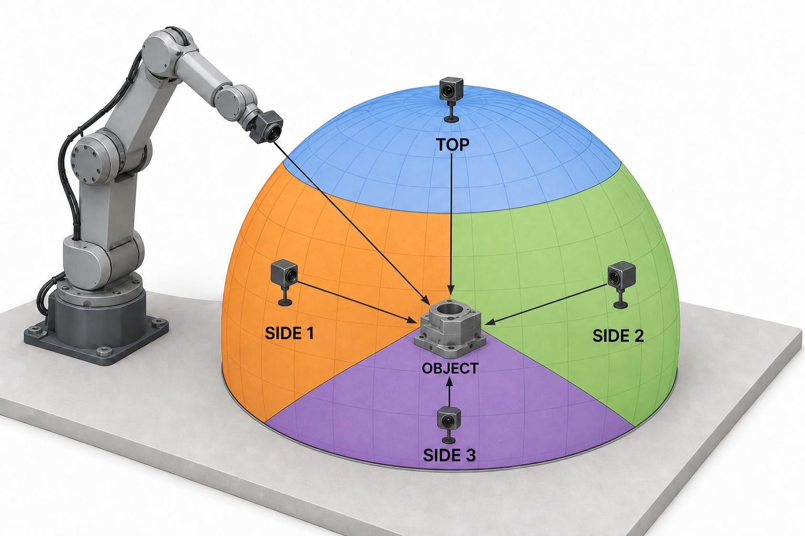

# FindVP: PyBullet simulation and Steve real robot

Choose the workflow you are running:

- **Simulation:** the PyBullet UR5e eye-in-hand environment and search scripts
  described below.
- **Steve, first three views:** [three-view runbook](./docs/steve_three_view_runbook.md).
  This captures and ranks three carton views, then returns to the best one.
- **Steve, full adaptive search:** [active-perception runbook](./docs/steve_active_perception_runbook.md).
  This continues triangle refinement and optional radial search on the robot.

The current Steve workflows live in [`real_robot/`](./real_robot/) and use the
CuRobo planner with Steve's trajectory controller; every move requires operator
approval. The older MoveIt-based `findvp_ros` adapter and its
[deployment documentation](./docs/real_robot_deployment.md) remain for
reference, but are **not** the commands for the current real-robot workflows.



It keeps:

- the tabletop UR5e eye-in-hand simulator
- the local UR5e description assets needed by PyBullet
- the sample workpiece mesh
- the C++ task code and assets under `tasks/`

The earlier Isaac Sim workflow and exported USD scene files are not part of
this repository. The current Steve tools are separate from that older bridge.

## Quick start: simulation

Run these commands on the host from the workspace root. Docker uses the local
`findvp-curobo:0.7.8` image if present, otherwise tries the namespaced Docker
Hub tag and builds from `Dockerfile.curobo-v1` if the pull is unavailable:
The namespaced tag is the Docker Hub pull name; the shorter tag is a local
alias used by the commands in this workspace.

```bash
cd findvp_ss26
if ! docker image inspect findvp-curobo:0.7.8 >/dev/null 2>&1; then
  if docker pull rafayaamirgull/findvp-curobo:0.7.8; then
    docker tag rafayaamirgull/findvp-curobo:0.7.8 findvp-curobo:0.7.8
  else
    docker build -f Dockerfile.curobo-v1 -t findvp-curobo:0.7.8 .
  fi
fi
```

Verify the image:

```bash
docker run --rm --entrypoint python3 findvp-curobo:0.7.8 \
  -c 'import pybullet, torch, timm, curobo; print("FindVP image ready")'
```

Start a headless container. The workspace mount keeps the saved images on your
host; the cache mount avoids downloading DINOv3 weights every time:

```bash
docker run --rm -it --name findvp-sim \
  -v "$PWD:/workspace" \
  -v "$HOME/.cache/huggingface:/root/.cache/huggingface" \
  -w /workspace --entrypoint bash findvp-curobo:0.7.8
```

Inside the container, run a fast three-view check against the included Power
Drill target image. This uses PyBullet IK and does not require a GPU:

```bash
python3 sample/active_perception_triangles.py \
  --headless --ik-backend pybullet --motion-seconds 0 \
  --views 3 --object "Power Drill" --name drill_three \
  --target-image assets/examples/drill_target.png \
  --max-refinement-depth 0 --skip-radial-refinement \
  --output-dir output/pybullet/drill_three
```

Look for three `drill_three_view_0N.png` files, a printed `Level 0 winner`,
and `output/pybullet/drill_three/drill_three_refinement_summary.json`. The
output directory is on the host too. The first scoring run downloads DINOv3
weights, so it needs internet; later runs can use the cache.

For the **full adaptive simulation search**, keep the same container and run:

```bash
python3 sample/active_perception_triangles.py \
  --headless --ik-backend pybullet --motion-seconds 0 \
  --views 3 --object "Power Drill" --name drill_adaptive \
  --target-image assets/examples/drill_target.png \
  --similarity-threshold 0.95 --max-refinement-depth 4 \
  --output-dir output/pybullet/drill_adaptive
```

This continues into triangle refinement and, unless a stop condition is met,
radial refinement. Inspect `drill_adaptive_refinement_summary.json`, the
captured PNGs, and `drill_adaptive_evaluation.txt` in that output directory.
The object and target are examples; substitute your own PLY and target image
after this check succeeds. Type `exit` to leave the container.

## Repository Layout

- [sample/pybullet_tabletop_ur5e_eye_in_hand.py](./sample/pybullet_tabletop_ur5e_eye_in_hand.py)
  Main PyBullet scene script.
- [sample/curobo_reachability.py](./sample/curobo_reachability.py)
  Dual CuRobo V1/V2 goal-set IK adapter and pure frame/scene helpers.
- [sample/curobo_motion.py](./sample/curobo_motion.py)
  Lazy CuRobo V1/V2 collision-aware joint-space motion planner.
- [sample/prepare_curobo_robot.py](./sample/prepare_curobo_robot.py)
  Generates the base-rooted UR5e + optical-camera URDF and generation-specific YAML.
- [sample/viewpoint_reachability.py](./sample/viewpoint_reachability.py)
  Simulator-independent viewpoint, pose, and IK data contracts.
- [sample/capture_four_views.py](./sample/capture_four_views.py)
  Collision-validated capture of four equal-solid-angle hemisphere views with
  timestamped robot and camera-pose metadata.
- [sample/active_perception_triangles.py](./sample/active_perception_triangles.py)
  Incumbent-preserving target-guided search over 3, 4, or 5 equal spherical
  triangles, with unreachable-point recovery, radial fine alignment, and
  benchmark evaluation reports; also provides the experimental Bayesian NBV mode.
- [sample/next_best_view.py](./sample/next_best_view.py)
  NumPy-only Bayesian viewpoint selection using observed similarity, uncertainty,
  and a camera-travel cost proxy, without triangle subdivision.
- [sample/geometric_view_search.py](./sample/geometric_view_search.py)
  RGB feature correspondences and essential-matrix relative pose for proposing
  camera moves directly, without a learned score model or triangle subdivision.
- [sample/target_guided_similarity.py](./sample/target_guided_similarity.py)
  Object-masked DINOv3 plus geometrically verified SIFT view ranking.
- [sample/visualize_end_effector_capture_poses.py](./sample/visualize_end_effector_capture_poses.py)
  Draws optical-camera frustums, sampled RGB image planes, and a spherical-
  obstacle-avoiding path through the saved capture sequence.
- [sample/workcell_config.py](./sample/workcell_config.py)
  Side-effect-free robot, camera, table, and workpiece configuration.
- [sample/dinov3_feature_matching.py](./sample/dinov3_feature_matching.py)
  Dense DINOv3 image feature extraction and mutual-nearest feature matching.
- [sample/dinov3_spatial_clustering.py](./sample/dinov3_spatial_clustering.py)
  Zero-shot PCA/K-Means object masks and object-level DINOv3 similarity.
- [notebooks/dinov3_feature_matching.ipynb](./notebooks/dinov3_feature_matching.ipynb)
  Runnable DINOv3 extraction and matching walkthrough.
- [docs/curobo_reachability.md](./docs/curobo_reachability.md)
  Detailed CuRobo environment, frame, solver, and safety documentation.
- [docs/rgb_localization.md](./docs/rgb_localization.md)
  Optional RGB-only multi-view target localization, calibration requirements,
  recorded-observation workflow, and limits of the estimated aiming point.
- [assets/steve_description](./assets/steve_description)
  Minimal local UR5e robot description used by the PyBullet script.
- [tasks/3d_models/obj_000020.ply](./tasks/3d_models/obj_000020.ply)
  Sample object placed on the table.
- [tasks/](./tasks/)
  C++ task code and supporting assets.
- [Dockerfile](./Dockerfile)
  Ubuntu 24.04 development image with PyBullet, OpenCV, PCL, and Eigen.
- [Dockerfile.curobo-v1](./Dockerfile.curobo-v1)
  Pinned CuRobo v0.7.8/CUDA 12.2 image for the RTX 3060 and R535 driver

## What The PyBullet Scene Provides

The simulator builds a static tabletop workcell with:

- a fixed-base UR5e mounted on a table
- a wrist-mounted RGB camera in an eye-in-hand setup
- the sample object on the table
- six GUI sliders for manual joint control
- keyboard shortcuts for homing, saving frames, and quitting

Important control detail:

- the arm is driven kinematically for stable viewpoint control
- this is intentional for view-planning work
- it is not meant to be a contact-dynamics or grasping benchmark

## Alternative PyBullet-only image

The quick start above uses the CuRobo image for target-guided scoring and for
the real-robot planner. For camera and IK demos without DINOv3 scoring, you can
instead build the smaller PyBullet image from this directory:

```bash
docker build -t findvp-pybullet-env:24.04 .
```

### Run the PyBullet-only container

Allow local X11 access first on the host:

```bash
xhost +SI:localuser:root
```

Then start the container:

```bash
docker run -it --rm \
  --name findvp-pybullet \
  --network=host \
  -e DISPLAY=$DISPLAY \
  -v /tmp/.X11-unix:/tmp/.X11-unix \
  -v "$PWD":/workspace \
  findvp-pybullet-env:24.04
```

Inside the container you can verify the environment with:

```bash
check_env
```

## Run The PyBullet Scene

From the repository root:

```bash
python3 sample/pybullet_tabletop_ur5e_eye_in_hand.py
```

Useful variants:

```bash
python3 sample/pybullet_tabletop_ur5e_eye_in_hand.py --no-camera-feed
python3 sample/pybullet_tabletop_ur5e_eye_in_hand.py --headless
python3 sample/pybullet_tabletop_ur5e_eye_in_hand.py --object "Christmas Bear"
python3 sample/pybullet_tabletop_ur5e_eye_in_hand.py --object "Power Drill"
python3 sample/pybullet_tabletop_ur5e_eye_in_hand.py --workpiece-rotation-z 90
```

The GUI shows the UR5e capability map by default. On the first run it generates
and caches `output/ur5e_capability_map.npz`; later runs load it directly. Workspace
point size indicates reachability, blue-to-yellow color indicates manipulability,
and magenta tabletop points indicate inverse-reachability/base placeability. Use
`--no-capability-map` to hide it or `--capability-samples N` to change first-run
sampling density.

`--object` selects a `.ply` file by name from `tasks/3d_models/` and works with
every IK backend. If it is omitted, `obj_000020` is used. Keep names containing
spaces in quotes. `--workpiece-ply PATH` remains available for external meshes.
PLY vertex RGB is preserved in the GUI and wrist-camera images through an
automatically generated PyBullet texture; colourless meshes use the neutral
blue-grey fallback.

## Viewpoint Reachability

The 100-point Fibonacci shell is the deterministic Level 6 test fixture, not a
requirement of the reachability filter. Production callers can submit a list
containing one externally generated `ViewpointCandidate`; repeated one-item
calls exercise the same filtering path. Run the fixture headlessly with:

```bash
python3 sample/pybullet_tabletop_ur5e_eye_in_hand.py \
  --headless \
  --plan-viewpoints
```

The default `--ik-backend auto` policy prefers the pinned CuRobo V1 runtime and
`artifacts/curobo/ur5e_camera_curobo_v1.yml`. If the package, driver, Torch,
CUDA, or GPU runtime is unavailable, it reports the reason and uses PyBullet
multi-start IK. Explicit `--ik-backend curobo` remains strict, while explicit
`--ik-backend pybullet` does not probe CuRobo.

The JSON always reports the generator that actually ran in `backend`, and
records requested/effective policy plus any automatic fallback reason under
`backend_metadata.selection`.

For a capture-only active-perception pass, run:

```bash
python3 sample/active_perception_triangles.py --views 3 --name cube
```

Supplying `--target-image` enables the complete target-guided angular and radial
search. The current Power Drill configuration is:

```bash
python3 -m pip install -r requirements-dinov3.txt
python3 sample/active_perception_triangles.py \
  --views 3 \
  --object "Power Drill" \
  --name Drill \
  --target-image assets/examples/drill_target.png \
  --similarity-threshold 0.97 \
  --max-refinement-depth 7 \
  --motion-seconds 0.1 \
  --feature-max-image-size 448 \
  --angular-lookahead-margin 0.03 \
  --angular-lookahead-levels 1 \
  --radial-step 0.02 \
  --radial-probe-steps 2 \
  --radial-max-steps 10 \
  --radial-patience 2 \
  --radial-min-radius 0.20 \
  --radial-max-radius 0.60
```

To estimate the next camera pose directly from RGB feature matches, use:

```bash
time python3 sample/active_perception_triangles.py \
  --search-strategy geometric \
  --object "obj_000020" \
  --name Dog_geometric \
  --target-image assets/examples/dog_target.png \
  --similarity-threshold 0.97 \
  --search-max-views 8 \
  --headless
```

This experimental geometric mode starts with the same three available seed
directions as the Bayesian mode, but can act on a supported pose estimate before
capturing all three. It matches masked OpenCV SIFT features to the target and
uses [essential-matrix RANSAC and relative-pose recovery](https://docs.opencv.org/4.8.0/d9/d0c/group__calib3d.html)
to estimate the target camera's orientation in world coordinates. Estimates
require at least 15 positive-depth inliers, an inlier fraction of at least 25%,
and a camera elevation of at least 10°. The known object center and configured
`--radius` convert orientation into a proposed position. Its estimated camera
roll is preserved through IK; alternative 90° rolls are not substituted for an
estimated pose. Each captured result is evaluated with the same DINOv3/SIFT
similarity scorer as the other methods.

This uses RGB correspondences, camera calibration, the current measured camera
pose, and the known object center. It does **not** use target-pose sidecars,
simulator depth, or mesh raycasts for view selection. As with the other methods,
target pose metadata may be read later solely for evaluation. Essential-matrix
translation has unknown scale: this mode assumes the target looks at the object
center from the configured radius, using the simulator camera's field of view.
Different target radius, cropping/intrinsics, weak texture, repeated patterns,
or near-zero parallax can make the estimate inaccurate or unsupported.

If geometry is unsupported or a move fails validation, the next unused seed is
tried. Once seeds and supported estimates are exhausted, the best scored view
is returned with `geometric_no_supported_pose`. A supported estimate within
5 mm and 2° of a previously captured pose stops further duplicate probing
(`geometric_pose_converged` once no other proposal remains). A different roll
at the same position can still be tried. This is geometric convergence, not a
guarantee that the similarity threshold was reached. There is no radial sweep.

`--search-max-views`, `--search-patience`, and `--search-time-budget` are aliases
for the existing `--nbv-*` controls and work for both sequential strategies.
View budget, similarity threshold, stale-view patience, and the soft time budget
still apply. Do not combine either sequential strategy with `--until-convergence`.
The default evaluation label is `Geometric NBV (DINOv3+SIFT)`. The summary's
`next_best_view` section records correspondence evidence, estimates, rejected
motions, and per-observation geometry time. OpenCV is required and is already
installed in the project's CuRobo container.

Headless CuRobo trials on 2026-09-21, with the same Dog target used below:

| Method / object | Captured views | Best similarity | Process wall time |
| --- | ---: | ---: | ---: |
| Triangle convergence / Dog | 9 | 0.949 | 37.2 s |
| Bayesian NBV / Dog | 8 | 0.729 | 35.4 s |
| Geometric / Dog | 5 | 0.962 | 33.5 s |
| Geometric / Christmas Bear | 3 | 0.790 | 46.0 s |

The Bear run used target `Beer_level_01_view_01.png`, encountered a motion
planning failure, and ended without a further supported pose. These are single
runs: geometric search improved the Dog result but is not a general replacement
for the default method and has not met the 10–15-second runtime target. Generated
captures and reports are in `output/pybullet/geometric_validation/`.

To try Bayesian search without triangle subdivision, use:

```bash
time python3 sample/active_perception_triangles.py \
  --search-strategy nbv \
  --object "obj_000020" \
  --name Dog_nbv \
  --target-image assets/examples/dog_target.png \
  --similarity-threshold 0.97 \
  --nbv-max-views 8 \
  --headless
```

NBV starts with three spread-out views at 45° elevation, scoring each separately.
After that, it fits a small Gaussian-process model to **all observed similarities**
and chooses one next position by expected improvement divided by a camera-travel
cost proxy. This follows the general [Bayesian optimization expected-improvement
approach](https://arxiv.org/abs/1206.2944); it is a new experimental implementation,
not a reproduction of a published viewpoint-selection method.

Candidate generation combines 128 Fibonacci directions per radius with local
proposals around the best observation. The global pool uses `--radius` and
±4 cm; local proposals vary direction by 2°, 5°, 10°, and 20° and radius by
±2 cm, clipped to `--radial-min-radius`/`--radial-max-radius`. It can return to
any region instead of remaining inside the previous winner's triangle.
Only the selected position goes through IK, collision checks, motion planning,
capture, and the existing DINOv3/SIFT scorer. The same feature extractor and
prepared target are reused. Rejected proposals are excluded from future
selection and do not become low-score observations.

The GP uses unit directions (no azimuth wraparound discontinuity) and radius,
with fixed Matérn-5/2 length scales, empirical score variance, and a fixed
score-noise assumption. Its uncertainty
is a modeling heuristic, not a calibrated confidence guarantee. Camera distance
is a cheap travel proxy, not predicted joint-space motion time. Camera roll is
still selected by the existing IK checks, not optimized by the GP.

NBV stops on the similarity threshold, `--nbv-max-views` scored images (default
8, including the initial views), or `--nbv-patience` consecutive non-meaningful
gains (default 3) once at least 6 views have been scored. A meaningful gain is
`--min-score-improvement` (default 0.002). A smaller view budget takes precedence
over the six-view exploration period. Failed proposals are bounded separately
at four times the view budget. The highest-scoring observed pose is always kept.

Add `--nbv-time-budget 15` for a **soft** 15-second budget measured from entry to
the runner, including environment/model initialization. It is checked before
proposing another view and after IK. It cannot interrupt an in-progress model
load, motion/replanning, capture, or ranking operation; final reports and return
home also take time. It is not a hard 15-second process deadline and may finish
without a scored image if startup consumes the budget.

In NBV mode, `--views`, triangle depth/patience/look-ahead settings, and radial
probe/continuation controls do not select views. There is no separate radial
sweep. `--until-convergence` is specific to triangle search and cannot be combined
with NBV; use the NBV controls above. The default method label becomes
`Bayesian NBV (DINOv3+SIFT)` so evaluation CSVs separate it from the baseline.
The summary includes every proposal, rejection, predicted score/uncertainty,
and acquisition value under `next_best_view`. Existing file formats retain
legacy `triangle`/`triangle_path` fields as identifiers only; NBV records have
`stage: next_best_view` and no triangle vertices. Use a different `--name` per
method so captures and summaries do not overwrite each other.

This mode aims to reduce expensive observations; better similarity or a
10–15-second simulation runtime is not established. Compare final score,
captured views, and wall time against `--search-strategy triangles` on the same
targets and hardware, including cold-start overhead for both methods.

Initial headless CuRobo validation on `obj_000020`, using target
`object_fine_02_view_05.png` (2026-09-21):

| Method | Captured views | Best similarity | Process wall time |
| --- | ---: | ---: | ---: |
| Triangles with `--until-convergence` | 9 | 0.949 | 37.2 s |
| Bayesian NBV, eight-view budget | 8 | 0.729 | 35.4 s |

These are single runs, not statistical benchmarks. Both used the same three
initial camera directions, feature settings, target, and container. The NBV run
used threshold 0.97; triangle convergence stopped on its plateau rule. NBV did
not provide a better accuracy/runtime tradeoff on this target, so triangle search
remains the default. Raw captures and evaluation files from this local validation
are in `output/pybullet/nbv_validation/` (generated output, not source files).

For a triangle search that ends as soon as the best similarity plateaus, use:

```bash
python3 sample/active_perception_triangles.py \
  --object "obj_000020" \
  --name Dog_convergence \
  --target-image assets/examples/dog_target.png \
  --until-convergence \
  --headless
```

`--until-convergence` requires a target image and overrides `--views` to 3,
`--similarity-threshold`, `--max-refinement-depth`, `--refinement-patience`,
`--min-score-improvement`, and both `--angular-lookahead-*` controls. You can
leave those flags in an existing command; their search settings are ignored.
Radial refinement is disabled, so stopping ends the entire search, followed by
report writing and the usual return home. Object/target selection, similarity
weights, image resolution, debug output, motion settings, and reachability and
collision checks still apply.

The initial level establishes the best score. Each later level compares its
winner with the previous global best. A gain below
`--convergence-min-improvement` (default `0.002`, an absolute score difference)
counts toward `--convergence-patience` (default `1`). A meaningful gain resets
patience; every higher score is retained even if its gain is below the tolerance.
Use `--convergence-patience 2` to tolerate one temporary dip, or increase
`--convergence-min-improvement` to stop on smaller gains sooner. This is a local
plateau heuristic, not proof of a global optimum: the default can miss a later
improvement after a dip and does not explore radial improvements. Exhausted
reachable viewpoints also end the run. The summary records the effective
settings and `similarity_converged` when the plateau rule triggers.

This reduces captures and ranking passes but does not impose a runtime budget.
Planner/model initialization, motion replanning, feature matching, and final
reporting still contribute to wall time; a 10–15 second runtime needs measurement
on the same machine and is not guaranteed by this flag.

Every successful run now prints and saves the benchmark fields `Method`,
`n_views`, `d_target`, `d_traveled`, `t_exec`, `PSNR`, and `SSIM`. Use
`--method-name "Ours: angular + radial DINOv3/SIFT"` to set the report label.
`d_target` requires the ground-truth camera pose that produced the target image.
Pass its PyBullet-world camera center directly:

```bash
--target-camera-position TARGET_X TARGET_Y TARGET_Z
```

Alternatively, use `--target-pose-json FILE`; without either option, the script
searches JSON files beside the target image for a matching `image_file` or
`image_filename` record. If no matching pose is found, `d_target` is reported as
`N/A` instead of being conflated with object distance.

The command writes immutable `Drill_evaluation_<UTC_RUN_ID>.json` and `.txt`
reports, updates `Drill_evaluation.json` and `Drill_evaluation.txt` as stable
latest-run files, and appends `Drill_evaluation_runs.csv`. The reports preserve
the target/final images, target and final poses, camera and end-effector motion
segments, exact units and definitions, termination reasons, full-frame
PSNR/SSIM details, and mean ± sample-standard-deviation aggregates for runs
sharing the same method label.

Add `--debug` only when cluster maps, feature-match plots, and target/candidate
comparison panels are needed. Ranking and refinement no longer require debug
mode.

For a headless run, add `--headless`:

```bash
python3 sample/active_perception_triangles.py \
  --headless \
  --views 3 \
  --object obj_000020 \
  --name object \
  --target-image /absolute/path/to/target.png \
  --similarity-threshold 0.95 \
  --max-refinement-depth 4
```

The default `--ik-backend auto` uses CuRobo for IK and motion when its reviewed
runtime is available; otherwise it uses PyBullet IK and a PyBullet-validated
joint-linear path. Use `--ik-backend curobo --curobo-robot-config PATH` to make
CuRobo mandatory. The DINO extractor defaults to a maximum image side of 448
pixels; `--feature-max-image-size 640` restores the previous, slower setting.

It writes `cube_view_01.png`, `cube_view_02.png`, and so on, plus all triangle
vertices, centroid coordinates, robot joints, and reachability/manipulability
results in `output/pybullet/triangle_views/cube_viewpoints.json`.
Every run also writes `cube_end_effector_capture_poses.json`. It contains
exactly one numbered record per saved angular or radial image: the stage,
picture number, image filename, triangle path, six joint values, camera pose,
and world-frame `ur5e_tool0` position and XYZW quaternion. The adjacent
`cube_end_effector_capture_poses.ply` contains one colored vertex per image;
its vertex normal is the tool frame's +Z axis for inspection in MeshLab. Motion
interpolation and return-home waypoints are not included.

To reproduce the supervisor-style view/image/path visualization in PyBullet,
first run the capture-only `--name cube` command above. The generated capture
JSON files are not included in the source tree:

```bash
python3 sample/visualize_end_effector_capture_poses.py \
  --captures output/pybullet/triangle_views/cube_end_effector_capture_poses.json
```

**Example-object trajectory**



**Power Drill trajectory** — 10 captured views; Picture 7 is the best view at
similarity `0.9705`.


**Beer run / Christmas Bear trajectory** — the `Beer` capture report references
the Christmas Bear mesh. It contains 16 captured views; Picture 4 is the best
view at similarity `0.5986`.



Each optical view receives a distinct high-contrast frustum/rectangle color.
The visualizer automatically reads `<name>_refinement_summary.json` and marks
the global winner with a slightly larger, thick bright-green frustum, a camera-center
sphere and object-pointing ray, plus an explicit `BEST VIEW` score label. Each
saved RGB image is sampled onto its oriented image plane, and a purple polyline
connects the camera centers. A direct transition that would enter the workpiece
bounding sphere follows the sphere surface instead. The default avoidance
radius is the mesh bounding radius plus `0.02 m`.

Compact defaults use an `0.08 m` frustum, `0.045 x 0.034 m` tool rectangles,
`0.75` normal labels, and a `1.05` best-view label. Tune them with
`--frustum-depth`, `--rectangle-width`, `--rectangle-height`, `--label-size`,
`--best-label-size`, and `--best-view-scale`. Other useful controls include
`--image-sample-step 4`, `--path-step 0.01`, `--obstacle-padding 0.02`, and
`--show-obstacle-sphere`. Add `--cycle-robot` to replay the discrete joint
states. Use `--best-picture N` to override the automatically selected winner.
The README animation can be regenerated directly from the PyBullet viewport
after the capture-only `--name cube` run above:

```bash
python3 sample/visualize_end_effector_capture_poses.py \
  --captures output/pybullet/triangle_views/cube_end_effector_capture_poses.json \
  --show-obstacle-sphere \
  --image-sample-step 8 \
  --path-step 0.01 \
  --obstacle-padding 0.02 \
  --label-size 0.75 \
  --best-label-size 1.05 \
  --best-view-scale 1.15 \
  --rectangle-width 0.045 \
  --rectangle-height 0.034 \
  --viewer-distance 0.95 \
  --gif-output docs/images/active-perception/trajectory-visualization.gif
```

GIF export hides the PyBullet control panels, records a seamless 360-degree
orbit, writes 48 frames at 12 FPS and exits automatically. It captures the
actual GUI so the X11 window must remain visible and unobscured while recording.
The Power Drill animation above uses the same presentation settings. Run the
`--name Drill` command above first to generate its capture JSON:

```bash
python3 sample/visualize_end_effector_capture_poses.py \
  --captures output/pybullet/triangle_views/Drill_end_effector_capture_poses.json \
  --show-obstacle-sphere \
  --image-sample-step 8 \
  --path-step 0.01 \
  --obstacle-padding 0.02 \
  --label-size 0.75 \
  --best-label-size 1.05 \
  --best-view-scale 1.15 \
  --rectangle-width 0.045 \
  --rectangle-height 0.034 \
  --viewer-distance 0.95 \
  --gif-output docs/images/active-perception/drill-trajectory-visualization.gif
```

The `Beer` example below also requires its capture JSON from the original
16-view run; generated capture files are excluded from this source tree.
Because that run contains 16 overlapping views, its optical frustums and
projected image planes use smaller depths than the other examples. These are
controlled by `--frustum-depth` and `--image-depth`; `--rectangle-width` and
`--rectangle-height` only affect the optional `--show-tool-rectangles` layer.

```bash
python3 sample/visualize_end_effector_capture_poses.py \
  --captures output/pybullet/triangle_views/Beer_end_effector_capture_poses.json \
  --show-obstacle-sphere \
  --image-sample-step 8 \
  --frustum-depth 0.045 \
  --image-depth 0.044 \
  --path-step 0.01 \
  --obstacle-padding 0.02 \
  --label-size 0.60 \
  --best-label-size 0.90 \
  --best-view-scale 1.15 \
  --viewer-distance 0.95 \
  --gif-output docs/images/active-perception/beer-trajectory-visualization.gif
```

The previous tool-frame rectangles remain available as a uniquely colored
overlay; its best rectangle is also enlarged and highlighted:

```bash
python3 sample/visualize_end_effector_capture_poses.py \
  --captures output/pybullet/triangle_views/cube_end_effector_capture_poses.json \
  --show-tool-rectangles \
  --rectangle-width 0.045 \
  --rectangle-height 0.034 \
  --label-size 0.75 \
  --best-label-size 1.05
```

With `--target-image`, the pipeline ranks the initial views and divides the
winning spherical triangle into three children. It captures and ranks the child
centroids while preserving the highest-scoring observation seen at any level.
In the default mode, angular refinement stops at the similarity/depth bounds, after
`--refinement-patience` non-meaningful levels, or when a worse child is outside
the configured look-ahead margin/budget. A nominally unreachable triangle is
first retried at nearby in-triangle points; if none passes validation, only that
triangle is skipped and the remaining candidates continue.

Unless `--until-convergence` or `--skip-radial-refinement` is set, after angular
search radial fine alignment returns to the exact saved joint
state of the global angular winner. It probes `--radial-probe-steps` positions
both closer to and farther from the object along the same camera-to-object ray,
keeps the camera aimed at the object center, selects an improving direction,
and continues until its score plateaus, a reachability/motion failure occurs,
the radius bounds are reached, or `--radial-max-steps` is exhausted. Use
`--skip-radial-refinement` to disable this final stage.

The robot stays at its current pose between angular levels by default and
returns home once in the final cleanup. `--return-home-each-level` restores the
older per-level return behavior. All candidate paths are still motion-planned
and revalidated before playback.

Level 0 keeps the original `cube_viewpoints.json` and ranking names. Refined
levels use `cube_level_01_viewpoints.json`, `cube_level_02_viewpoints.json`,
and so on. Radial output uses `cube_radial_{inside,outside}_NN.png`,
`cube_radial_viewpoints.json`, and `cube_radial_summary.json`.
`cube_refinement_summary.json` records the search settings, per-level timing,
global-incumbent decisions, angular termination reason, radial result, and the
best observation across both stages. In debug mode,
`cube_best_view_with_target.png` copies the overall winner's target/view panel;
without debug mode, `best_view_with_target` is `null`.

In target-guided mode, the RGB pipeline removes the flat
tabletop/background and any robot region connected to the image boundary. It
enlarges the remaining central-object crop, then runs dense DINOv3 and SIFT
only inside that mask. The default fusion favours DINOv3 (`0.75`) over SIFT
(`0.25`) because smooth simulation meshes often contain little repeatable
corner texture.

The active-perception and standalone ranking commands always perform the
explicitly requested ranking. Extra full-frame DINO extraction, PCA/K-Means
clustering, and rendered match/comparison panels require `--debug`. Without it,
the ranking JSON stores `"visualizations": null`.

With `--debug`, it also creates `cube_viewpoints_visualizations/` containing:

- `target_clustering.png`, including the selected mask and green crop box;
- one DINO cluster/mask visualization for every triangle;
- one dense DINO feature-match image for every target/triangle pair;
- one SIFT/RANSAC match image for every target/triangle pair;
- `best_triangle_XX.png`, with the target and winning image side by side.

All absolute image paths are also stored under `visualizations` in the ranking
JSON.

### Example result

This earlier angular-only run captured 15 images across five levels and
followed triangle path `[3, 1, 3, 3, 1]`. The winning combined score improved
from `0.669` at the coarse level to `0.868`; the configured depth bound stopped
the run. Current target-guided runs add radial captures unless
`--skip-radial-refinement` is supplied.


The saved diagnostics make the decision inspectable instead of exposing only
the final score. This example has 380 target and 380 candidate DINO object
features, 21 mutual matches, and 13 fundamental-matrix RANSAC inliers.


For each viewpoint, the pipeline:

- aims the optical camera `+Z` axis at the workpiece
- treats camera roll as task redundancy and tries `0, 90, -90, 180` degrees
- generates IK branches with the selected PyBullet or CuRobo backend
- validates every branch in PyBullet using joint limits, camera FK residual,
  clearance, self-collision, and line of sight
- keeps the best valid branch using manipulability, joint-limit margin,
  clearance, and joint travel

The fixture samples 100 equal-area shell positions and writes every accepted or
rejected candidate, including per-gate diagnostics, to:

```text
output/pybullet/reachable_viewpoints.json
```

Useful options:

```bash
# Display accepted points in green and rejected points in red.
python3 sample/pybullet_tabletop_ur5e_eye_in_hand.py \
  --plan-viewpoints \
  --visualize-viewpoints

# Also annotate a discretized joint-linear path from the current pose.
python3 sample/pybullet_tabletop_ur5e_eye_in_hand.py \
  --headless \
  --plan-viewpoints \
  --path-validation-steps 50

# Increase roll redundancy or change the fixture shell.
python3 sample/pybullet_tabletop_ur5e_eye_in_hand.py \
  --headless \
  --plan-viewpoints \
  --ik-backend pybullet \
  --ik-rolls 0,45,-45,90,-90,135,-135,180 \
  --ik-seeds 6 \
  --view-radius-min 0.35 \
  --view-radius-max 0.55
```

Endpoint IK and motion reachability are different. The optional straight
joint-space path samples are diagnostics and do not change endpoint acceptance.
A rejection means the finite search found no valid branch; it is not a proof
that no IK solution exists. The model also omits the source gripper assembly,
so the result is not a hardware collision certificate.

Each filter call captures the six entry joints and restores them before
returning. The same `finally`-guarded restoration runs when candidate
generation or validation raises, so filtering does not permanently command the
selected solution.

## Interactive CuRobo Motion Planning

With a reviewed collision-aware CuRobo robot config, a GUI reachability run
also enables Level 7 motion planning:

```bash
python3 sample/pybullet_tabletop_ur5e_eye_in_hand.py \
  --plan-viewpoints \
  --ik-backend curobo \
  --curobo-robot-config artifacts/curobo/ur5e_camera_curobo_v2.yml
```

Accepted points are green and rejected points are red. Click a point, then
click **Move to selected viewpoint (CuRobo)** in the Params panel. Selecting a
red point reports that it is not reachable and asks for another selection.

For a green point, CuRobo plans from the current joints to the Level 6 selected
joint solution. PyBullet then checks every returned waypoint plus subdivisions
of at most `0.02 rad` per joint step. Playback starts only if the complete dense
path passes joint-limit and clearance checks. Planning runs in a background
thread while the GUI holds the captured start state.

The default V1 preparation on the current R535 system verifies the local UR5e
geometry against CuRobo v0.7.8's bundled model, maps its collision spheres, and
adds a conservative camera sphere. This enables the same Level 7 workflow on
the RTX 3060. `--v1-ik-only` remains available and produces a config that Level
7 deliberately rejects. See the
[Level 7 guide](./docs/wiki/Level-7-CuRobo-Motion-Planning.md).

## Four-View Hemisphere Capture



The upper hemisphere is divided into four equal-solid-angle regions: one top
cap and three 120-degree side sectors. The capture workflow first tries one
analytic representative from each region. If a representative is unreachable,
it deterministically searches other positions inside that same region, aims
the wrist camera at the object center, validates the endpoint and complete
motion in PyBullet, and saves timestamped RGB images with robot, camera, IK,
and trajectory metadata.

Run the workflow headlessly with automatic backend selection:

```bash
python3 sample/capture_four_views.py --headless
```

The default output directory is `output/pybullet/four_views`. See the
[Four-View Capture wiki page](./docs/wiki/Four-View-Capture.md) for the exact
partition geometry, backend behavior, output schema, and limitations.

## CuRobo On The Current RTX 3060 / R535 System

For the RTX 3060 Laptop GPU and NVIDIA driver `535.261.03`, use the pinned
CuRobo `v0.7.8`/CUDA 12.2 container. It avoids depending on the host's Python,
Torch, CUDA toolkit, or NVCC versions.
The [quick start](#quick-start-simulation) prepares the same local image tag;
the GUI command below adds GPU and X11 access.

```bash
xhost +SI:localuser:root

docker run -it --rm \
  --name findvp-curobo \
  --gpus all \
  --ipc=host \
  --network=host \
  -e DISPLAY="$DISPLAY" \
  -e NVIDIA_DRIVER_CAPABILITIES=compute,utility,graphics,display \
  -v /tmp/.X11-unix:/tmp/.X11-unix \
  -v "$PWD":/workspace \
  findvp-curobo:0.7.8
```

`--ipc=host` lets the X server access the MIT-SHM image buffers created by
PyBullet. The `graphics,display` driver capabilities expose NVIDIA OpenGL/GLX
in addition to CUDA. Without them, CuRobo can still report an available CUDA
device while the PyBullet GUI falls back to Mesa `llvmpipe` and may terminate
with `X_ShmPutImage: BadValue`. Use `--headless` when no GUI is needed.

Inside the container, verify CUDA and generate the camera-aware V1 robot files:

```bash
check_env
cd /workspace
python3 sample/prepare_curobo_robot.py --api-version v1
```

Generated configuration paths are absolute, so rerun preparation after moving
or remounting the checkout.

After preparation, the default automatic policy uses this V1 configuration:

```bash
python3 sample/pybullet_tabletop_ur5e_eye_in_hand.py \
  --headless \
  --plan-viewpoints \
  --viewpoint-output output/pybullet/reachable_viewpoints_curobo_v1.json
```

To require CuRobo and turn any runtime-unavailability condition into a hard
error, run:

```bash
python3 sample/pybullet_tabletop_ur5e_eye_in_hand.py \
  --headless \
  --plan-viewpoints \
  --ik-backend curobo \
  --curobo-robot-config artifacts/curobo/ur5e_camera_curobo_v1.yml \
  --viewpoint-output output/pybullet/reachable_viewpoints_curobo_v1.json
```

CuRobo V1 proposes IK branches sequentially with `B=1`; PyBullet remains the
authoritative endpoint collision and FK validator. Automatic fallback is
limited to typed runtime-availability failures during preflight. Missing or
malformed configuration on a usable V1 runtime, schema errors, solver failures,
and malformed results remain hard failures. There is no fallback when CuRobo is
explicitly selected. The adapter also retains a separate V2 path for
`nvidia-curobo==0.8.x` on an R580+ environment. See the
[CuRobo backend guide](./docs/curobo_reachability.md) for version requirements,
license constraints, frames, result contracts, safety boundaries, and V2 setup.

The V1 path was exercised on the target RTX 3060/R535 machine. With the
world-up roll-0 default, the real 100-viewpoint fixture produced 64
PyBullet-validated endpoints in about `10.85 s` on 2026-07-23. An earlier
explicit four-roll run (`--ik-rolls 0,90,-90,180`) produced 88 endpoints in
about `10.05 s`, but its selected camera frames can be rotated. Treat both as
execution evidence rather than fixed accepted-count regressions.

## Tests

Run the Python test suite from this directory with:

```bash
PYTEST_DISABLE_PLUGIN_AUTOLOAD=1 PYTHONPATH=. python3 -m pytest -q
```

## DINOv3 Image Feature Matching

Install the optional notebook and DINOv3 dependencies:

```bash
python3 -m pip install -r requirements-dinov3.txt
jupyter lab notebooks/dinov3_feature_matching.ipynb
```

When using `findvp-curobo:0.7.8`, rebuild it from the updated
`Dockerfile.curobo-v1`; timm, scikit-learn, and Matplotlib are already included and
the image retains NVIDIA's CuRobo-compatible CUDA 12.2 PyTorch build:

```bash
docker build -f Dockerfile.curobo-v1 -t findvp-curobo:0.7.8 .
```

To retain downloaded model weights across disposable containers, mount the
Hugging Face cache when starting the image:

```bash
xhost +SI:localuser:root

docker run -it --rm \
  --name findvp-curobo \
  --gpus all \
  --ipc=host \
  --network=host \
  -e DISPLAY="$DISPLAY" \
  -e NVIDIA_DRIVER_CAPABILITIES=compute,utility,graphics,display \
  -v /tmp/.X11-unix:/tmp/.X11-unix \
  -v "$PWD":/workspace \
  -v "$HOME/.cache/huggingface:/root/.cache/huggingface" \
  findvp-curobo:0.7.8
```

The default `vit_small_patch16_dinov3.lvd1689m` checkpoint can require
accepting Meta's model license on Hugging Face and authenticating with
`hf auth login`. The first extractor construction downloads the weights; later
runs use the Hugging Face cache.

The Python API preserves image aspect ratio, returns normalized DINOv3 patch
descriptors with their original-image `(x, y)` centres, and matches two feature
sets using cosine mutual nearest neighbours:

```python
from sample.dinov3_feature_matching import (
    DINOv3FeatureExtractor,
    load_image,
    match_features,
)

image1 = load_image("path/to/first.png", grayscale=True)
image2 = load_image("path/to/second.png", grayscale=True)
extractor = DINOv3FeatureExtractor(
    max_image_size=640,
    upscale_small_images=True,
    white_background_threshold=0.95,
    min_foreground_fraction=0.10,
)
features1 = extractor.extract(image1)
features2 = extractor.extract(image2)
matches = match_features(features1, features2, similarity_threshold=0.70)
```

### Zero-shot spatial object similarity

Spatial clustering requires the complete patch grid, rather than the
background-filtered descriptors used by ordinary feature matching. Extract it
with `apply_background_filter=False`, cluster both views, inspect the masks,
and compute the directional maximum-cosine score:

```python
from sample.dinov3_spatial_clustering import (
    DINOv3SpatialClusterer,
    compute_object_similarity,
    format_cluster_report,
)

full1 = extractor.extract(image1, apply_background_filter=False)
full2 = extractor.extract(image2, apply_background_filter=False)

clusterer = DINOv3SpatialClusterer(
    n_clusters=4,
    pca_components=64,
    random_state=0,
    white_background_threshold=0.95,
)
mask1 = clusterer.fit_predict(full1, image=image1)
mask2 = clusterer.fit_predict(full2, image=image2)
print(format_cluster_report(mask1))
print(format_cluster_report(mask2))

score = compute_object_similarity(full1, mask1, full2, mask2)
print(score.score)            # exact current -> target formulation
print(score.symmetric_score)  # mean of both directions, as a diagnostic
```

PCA and K-Means are deterministic for a fixed input and `random_state`. Object
selection remains an unsupervised hypothesis: inspect the notebook label maps
and reports. If automatic selection is wrong, pass explicit cluster IDs such
as `object_cluster_ids=(1, 3)` to `fit_predict`. Increasing `n_clusters` can
separate object parts more finely, but it does not increase the underlying
DINOv3 patch resolution; use `max_image_size` and `upscale_small_images` for a
denser feature grid.

## GUI Controls

The PyBullet **Params** panel includes a **Save wrist-camera image...** button.
Click it to open a save dialog, choose any local directory and filename, and
save the camera's current RGB frame. PNG and JPEG filenames are supported.

After a GUI `--plan-viewpoints` run, it also includes **Move to selected
viewpoint (CuRobo)**. Click a rendered viewpoint first; the simulator reports
unreachable selections and only executes a CuRobo path after dense PyBullet
revalidation.

Keyboard shortcuts in GUI mode:

- `h` resets the robot to the home pose and holds it there until you move a slider
- `c` saves the latest wrist-camera RGB frame to `output/pybullet/`
- `q` quits

## Camera / Robot Notes

- The UR5e source description now lives under `assets/steve_description/`.
- The script generates a cleaned PyBullet runtime URDF under `artifacts/pybullet/`.
- If `artifacts/pybullet/` is not writable, it falls back to `/tmp/findvp_pybullet_assets/`.
- The wrist camera is rendered from the end-effector-mounted frame each update cycle.

## Build The C++ Tasks

The task binaries still build from `tasks/`:

```bash
cmake -S tasks -B tasks/build
cmake --build tasks/build -j4
```

Binaries are written to:

```bash
tasks/build/bin/
```

## Current Similarity Metrics

The Python helper utilities and task-side comparison logic in this repo currently use image similarity metrics of this form:

- `raw_sad = sum(|I_a - I_b|)`
- `nmae = mean(|I_a - I_b| / 255)`
- `ssim` as the standard structural similarity index over the aligned images
- `zncc` as zero-mean normalized cross-correlation

For `zncc`, with images flattened to pixel vectors:

```text
ZNCC(I_a, I_b) =
sum((I_a - mean(I_a)) * (I_b - mean(I_b))) /
sqrt(sum((I_a - mean(I_a))^2) * sum((I_b - mean(I_b))^2))
```

Interpretation:

- `ZNCC = 1` means perfect positive match
- `ZNCC = 0` means no linear correlation
- `ZNCC = -1` means perfect negative correlation

## Ignored / Generated Paths

The following are treated as generated and should not be committed:

- `artifacts/`
- `build/`
- `output/`
- `__pycache__/`
- `tasks/build/`
