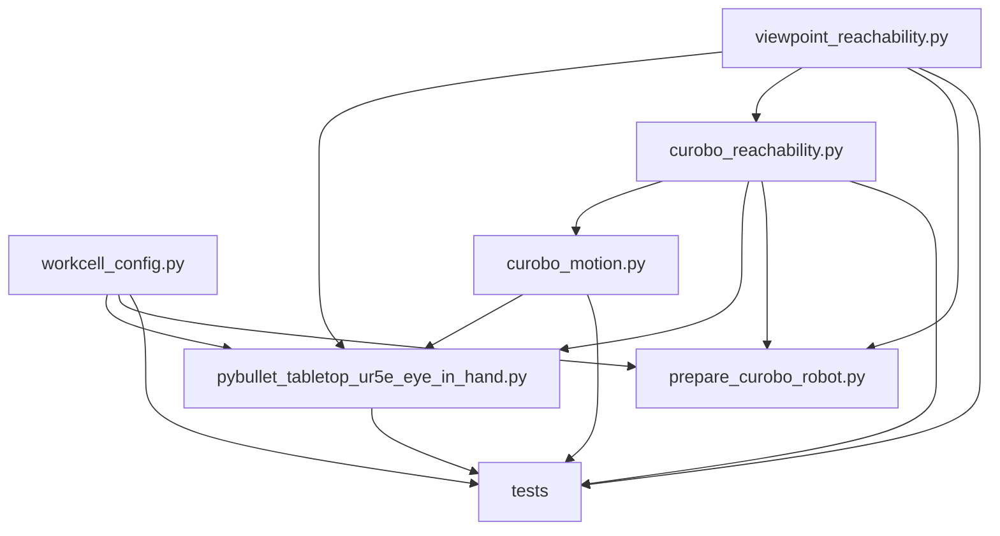

# Branch and Code Map

## Branch scope

The local implementation is on branch:

```text
dev/rafay_perception
```

The relevant milestones in the local history are:

| Commit | Purpose |
| --- | --- |
| `ec6aa12` | Add the tabletop PyBullet eye-in-hand environment |
| `355a09b` | Add Level 6, CuRobo support, shared modules, documentation, and cleanup |
| `2ad4efe` | Add the original sampling, PyBullet integration, and CuRobo adapter suite |
| `d1386dc` | Add deterministic DINOv3 spatial clustering and object similarity |
| `3c1efc1` | Add RGB-only SAM masking, corrected coordinate mapping, ambiguity filters, and geometric verification |
| `fd00b64` | Add four-view capture with motion planning, PyBullet revalidation, and pose metadata |
| `d787c81` | Add the combined DINO, geometry, and local-ZNCC image score |
| `591c121` | Rebuild the CuRobo image around the shared optional perception requirements |
| `7df4f7a` | Rank the latest complete four-view capture in the notebook |

The wiki source itself is maintained under `docs/wiki/` and is published
separately to the project's GitLab Wiki Git repository.

## Source map

| Path | Responsibility |
| --- | --- |
| `sample/workcell_config.py` | Side-effect-free workcell geometry, robot joints, camera constants, and transforms |
| `sample/viewpoint_reachability.py` | Simulator-independent viewpoint sampling, quaternion math, configuration, and IK backend data contracts |
| `sample/pybullet_tabletop_ur5e_eye_in_hand.py` | PyBullet world, robot control, IK candidate generation, endpoint validation, ranking, camera rendering, JSON output, and CLI |
| `sample/generate_capability_map.py` | Headless entry point for generating the cached UR5e reachability, manipulability, and inverse-reachability map |
| `sample/curobo_reachability.py` | Import-safe CuRobo runtime checks, goal packing, robot/scene preparation helpers, and V1/V2 candidate backends |
| `sample/curobo_motion.py` | Lazy CuRobo V1 MotionGen / V2 MotionPlanner adapter and dense trajectory normalization |
| `sample/prepare_curobo_robot.py` | Generates the camera-aware CuRobo URDF and generation-specific YAML |
| `sample/capture_four_views.py` | Four analytic hemisphere views, reachability, motion/revalidation, timestamped RGB capture, per-image metadata, and run manifest |
| `sample/active_perception_triangles.py` | Incumbent-preserving spherical-triangle search, unreachable-point fallback, CuRobo/PyBullet motion, DINO/SIFT ranking, radial fine alignment, and benchmark evaluation reports |
| `sample/visualize_end_effector_capture_poses.py` | Distinct optical frustums, projected RGB image planes, sphere-avoiding view path, summary-driven best-view emphasis, optional tool-frame overlays, X11 orbit-GIF export, and discrete robot replay |
| `sample/target_guided_similarity.py` | Object-masked DINOv3 and SIFT/RANSAC ranking with ambiguity-aware selection |
| `sample/dinov3_feature_matching.py` | DINOv3 dense descriptors, mask/ROI filtering, mutual-nearest matching, NumPy fundamental RANSAC, local ZNCC, and combined scoring |
| `sample/dinov3_spatial_clustering.py` | SAM proposal selection plus deterministic PCA/K-Means object-mask and directional object-similarity helpers |
| `notebooks/dinov3_feature_matching.ipynb` | Interactive SAM/DINO matching walkthrough and newest-complete-capture ranking workflow |
| `tests/test_viewpoint_reachability.py` | Pure sampling and roll tests |
| `tests/test_capture_four_views.py` | Capture-path revalidation and motion metadata contracts |
| `tests/test_dinov3_feature_matching.py` | Extraction, coordinate mapping, matching, RANSAC, ZNCC, and combined score tests |
| `tests/test_dinov3_spatial_clustering.py` | Automatic masks, clustering, overrides, reproducibility, and object-similarity tests |
| `tests/test_visualize_end_effector_capture_poses.py` | Capture-pose validation, frustum/image projection, sphere-avoiding geometry, compact defaults, and GIF window-selection tests |
| `tests/test_target_guided_similarity.py` | Score fusion, SIFT geometry, ranking, and winning-pose report tests |
| `tests/test_pybullet_reachability_integration.py` | PyBullet frames, collisions, capability-map generation/visualization, backend integration, JSON, safety validation, and client-isolation tests |
| `tests/test_curobo_reachability.py` | Host-safe CuRobo adapter, schema, packing, metric, and generated-model tests |
| `tests/test_curobo_motion.py` | Host-safe collision-config and motion-result contract tests |
| `Dockerfile` | Ubuntu 24.04 PyBullet/C++ development environment |
| `Dockerfile.curobo-v1` | Pinned CuRobo v0.7.8, CUDA 12.2, compute 8.6, and NVIDIA OpenGL/X11 container |
| `requirements-dinov3.txt` | Optional timm, Transformers/SAM, scikit-learn, scikit-image/SIFT, Pillow, Matplotlib, and Jupyter dependencies without replacing PyTorch |
| `docs/curobo_reachability.md` | Detailed in-repository CuRobo design and safety notes |

## Dependency direction



`workcell_config.py` and `viewpoint_reachability.py` do not import PyBullet or
CuRobo. `curobo_reachability.py` keeps Torch and CuRobo imports inside runtime
preflight and execution functions. The default automatic resolver can therefore
test V1 availability and choose PyBullet without eagerly importing CuRobo at
module import time; explicit PyBullet use remains safe on a host without CUDA
or CuRobo.

The perception helpers do not import PyBullet or CuRobo. Model construction is
lazy: importing the modules or running their unit tests does not download a
checkpoint. The notebook explicitly releases SAM from GPU memory before
loading DINOv3, and moves DINOv3 to CPU while segmenting the four capture
images to limit peak VRAM use.

## Source assets

| Asset | Purpose |
| --- | --- |
| `assets/steve_description/urdf/steve_ur5e.urdf` | Source UR5e/Steve robot description |
| `assets/steve_description/` | Robot meshes and supporting description files |
| `tasks/3d_models/obj_000020.ply` | Default workpiece mesh |

## Generated artifacts

Generated files are intentionally excluded from Git and Docker build context:

| Path | Produced by |
| --- | --- |
| `artifacts/pybullet/ur5e_pybullet_minimal.urdf` | PyBullet environment startup |
| `artifacts/pybullet/*.obj` | Runtime PLY-to-OBJ conversion |
| `artifacts/pybullet/*_palette.png` | Runtime texture preserving PLY vertex colours |
| `artifacts/curobo/ur5e_camera_curobo.urdf` | CuRobo preparation script |
| `artifacts/curobo/ur5e_camera_curobo_v1.yml` | CuRobo V1 preparation |
| `artifacts/curobo/ur5e_camera_curobo_v2.yml` | CuRobo V2 RobotBuilder path |
| `output/pybullet/*.png` | Ordinary wrist-camera captures |
| `output/pybullet/*.json` | Reachability reports |
| `output/ur5e_capability_map.npz` | Default-on PyBullet capability-map generation or `sample/generate_capability_map.py` |
| `output/pybullet/four_views/{top,side_1,side_2,side_3}_*.png` | Timestamped four-view RGB captures with embedded metadata |
| `output/pybullet/four_views/{top,side_1,side_2,side_3}_*.json` | Per-capture robot, camera, IK, and motion metadata |
| `output/pybullet/four_views/capture_manifest_*.json` | Incrementally written capture-run manifest and completion state |
| `output/pybullet/four_views/best_match_comparison.png` | Notebook visualization of the target and highest-ranked valid capture |
| `output/pybullet/triangle_views/*_viewpoints_ranking.json` | Target-guided triangle ranking and complete winning viewpoint record |
| `output/pybullet/triangle_views/*_end_effector_capture_poses.{json,ply}` | Numbered angular/radial image-capture states and MeshLab pose vertices |
| `output/pybullet/triangle_views/*_radial_viewpoints.json` | Closer/farther candidates, scores, reachability, motion evidence, and skipped samples |
| `output/pybullet/triangle_views/*_radial_summary.json` | Selected radial direction, stopping reason, and best radial/global observation |
| `output/pybullet/triangle_views/*_refinement_summary.json` | Angular incumbent/look-ahead history, per-level timings, radial result, and final best observation |
| `output/pybullet/triangle_views/*_evaluation_<UTC_RUN_ID>.{json,txt}` | Immutable per-run method/view/distance/time/PSNR/SSIM report with pose and motion evidence |
| `output/pybullet/triangle_views/*_evaluation.{json,txt}` | Stable latest-run evaluation reports |
| `output/pybullet/triangle_views/*_evaluation_runs.csv` | Append-only rows used for per-method mean ± sample-standard-deviation aggregation |
| Hugging Face cache | Downloaded SAM and DINOv3 weights; location is controlled by the runtime/Hugging Face configuration |

The PyBullet asset generator falls back to a unique directory under
`/tmp/findvp_pybullet_assets/` if `artifacts/pybullet/` is not writable.

## Runtime separation

- The default `Dockerfile` is the PyBullet and C++ development environment.
- `Dockerfile.curobo-v1` is the supported CuRobo path for the current RTX 3060
  Laptop GPU and R535 driver.
- CuRobo V2 is retained for a different R580+ environment and uses a distinct
  YAML schema.
- The default `--ik-backend auto` policy prefers pinned CuRobo V1 and falls
  back to PyBullet only when V1 preflight raises the typed runtime-unavailable
  error.
- Configuration/schema, backend construction, solver, result-contract, and
  validation errors remain hard failures; they never trigger CPU retry.
- Explicit `--ik-backend curobo` is strict. Explicit `--ik-backend pybullet`
  does not probe CuRobo.

Next: [PyBullet Environment](PyBullet-Environment) or
[Level 6 Reachability Pipeline](Level-6-Reachability-Pipeline).
