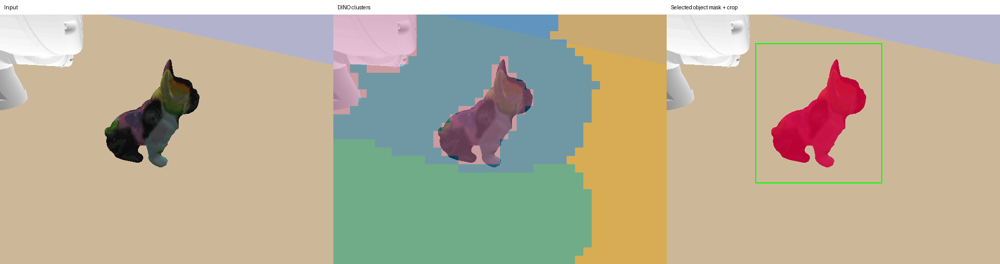
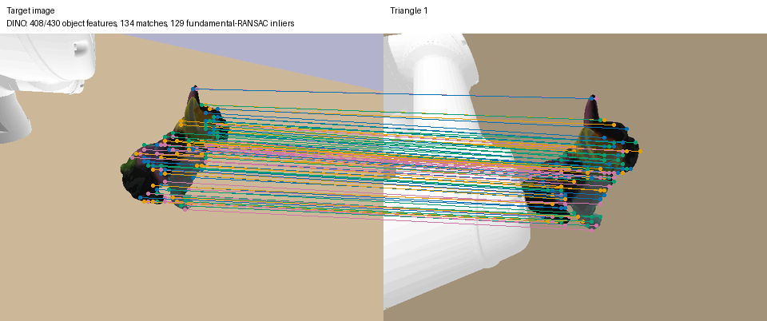
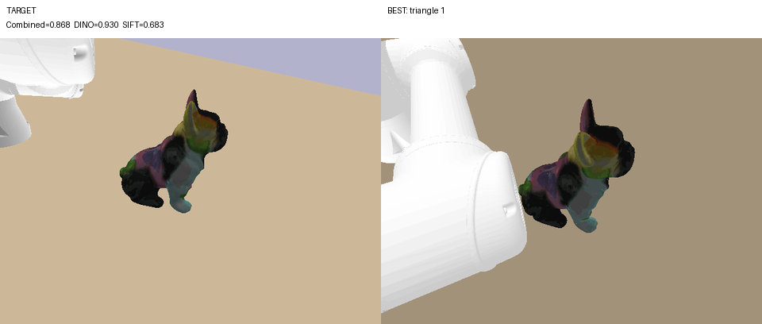

# DINOv3 Matching and Ranking

The perception utilities compare RGB images with dense DINOv3 patch features,
explicit object masking, two-view geometric verification, and local ZNCC. The
notebook demonstrates one pair and then ranks the newest complete four-view
capture against a target. Higher combined scores are better, but only images
that pass the geometric support gates are ranked.

## Install and run

Install a CUDA-compatible PyTorch separately, or use the rebuilt pinned CuRobo
V1 image. `requirements-dinov3.txt` deliberately does not install PyTorch so it
cannot replace the reviewed CUDA build.

```bash
python3 -m pip install -r requirements-dinov3.txt
jupyter lab notebooks/dinov3_feature_matching.ipynb
```

The optional stack currently includes `timm==1.0.20`,
`transformers==4.44.2`, `scikit-learn>=1.5.1`, `scikit-image>=0.24.0`, Pillow,
Matplotlib, and JupyterLab. The notebook uses `facebook/sam-vit-base` and
`vit_large_patch16_dinov3.lvd1689m`; the reusable extractor defaults to the
smaller `vit_small_patch16_dinov3.lvd1689m`. Checkpoint access can require
accepting the provider license and running `hf auth login`.

For disposable GPU containers, persist downloads by mounting the Hugging Face
cache:

```bash
xhost +SI:localuser:root

docker run -it --rm \
  --gpus all \
  --ipc=host \
  --network=host \
  -e DISPLAY="$DISPLAY" \
  -e NVIDIA_DRIVER_CAPABILITIES=compute,utility,graphics,display \
  -v /tmp/.X11-unix:/tmp/.X11-unix \
  -v "$PWD":/workspace \
  -v "$HOME/.cache/huggingface:/root/.cache/huggingface" \
  findvp-curobo:0.7.8
```

## Verified correspondence pipeline

The notebook's current RGB-only workflow is:

1. run SAM in segment-everything mode;
2. reject masks that are scene-sized, too small, or boundary-connected and
   select a useful isolated proposal;
3. pad its bounding box, crop it, and upscale the crop for a denser DINO grid;
4. extract L2-normalized DINOv3 patch descriptors while retaining the complete
   row-major grid;
5. filter descriptors by the selected binary mask and map crop-local patch
   centres back into full-image `(x, y)` coordinates;
6. form cosine mutual-nearest-neighbour matches;
7. estimate a fundamental matrix with deterministic NumPy RANSAC and reject
   geometric outliers;
8. calculate the combined DINO/geometry/local-ZNCC score.

No simulator segmentation, depth, category prompt, colour threshold, fixed
ROI, or fixed input size is used by this notebook path. Automatic proposal
selection assumes one salient object separated from the image boundary, so
the displayed masks and mapped coordinates must still be inspected.

The pairwise notebook currently requires at least 16 descriptor candidates,
then at least 12 RANSAC inliers and a 30% inlier ratio. Its matching threshold
is cosine `0.60` and its RANSAC threshold is `6 px`. Failed gates raise/report
an error instead of manufacturing a low score.

## Combined score

`score_image_match()` returns a detailed `ImageMatchScore` and a final value in
`[0, 1]`. With default weights:

```text
descriptor_score = clamp((mean_DINO_cosine + 1) / 2, 0, 1)
support          = min(1, inlier_count / 12)
geometric_score  = (inlier_count / candidate_count) * support
feature_score    = sqrt(descriptor_score * geometric_score)
zncc_score       = clamp((median_local_ZNCC + 1) / 2, 0, 1)
score            = 0.70 * feature_score + 0.30 * zncc_score
```

ZNCC is evaluated around geometrically verified keypoint pairs, not over the
whole image. Each patch radius is relative to its own image dimensions, both
patches are resized to `21 x 21`, near-constant patches are skipped, and the
median resists individual outliers. This supports translations and different
image sizes; it does not make the method invariant to arbitrary viewpoint,
occlusion, or segmentation errors.

## Ranking a four-view capture

The last notebook section scans
`output/pybullet/four_views/capture_manifest_*.json` newest first and selects
the newest manifest that:

- has `status: complete`;
- contains exactly `top`, `side_1`, `side_2`, and `side_3` records;
- references four existing image files.

It segments each robot image, compares it with the configured target from
`tests/data`, rejects comparisons that fail the same candidate/inlier gates,
sorts the remaining entries by combined score, prints score diagnostics, and
writes `best_match_comparison.png`. It does not change the manifest or label a
failed comparison as a valid zero-score match.

## Target-guided triangle capture

`sample/active_perception_triangles.py` runs incumbent-preserving angular
search and bounded radial fine alignment in one command:

```bash
python3 sample/active_perception_triangles.py \
  --views 3 \
  --object "Power Drill" \
  --name Drill \
  --target-image output/pybullet/wrist_camera_latest_1788213774.png \
  --similarity-threshold 0.97 \
  --max-refinement-depth 7 \
  --motion-seconds 0.1 \
  --feature-max-image-size 448 \
  --angular-lookahead-margin 0.03 \
  --angular-lookahead-levels 1 \
  --radial-step 0.02 \
  --radial-probe-steps 2 \
  --radial-max-steps 10 \
  --radial-patience 2 \
  --radial-min-radius 0.20 \
  --radial-max-radius 0.60
```

At completion, the command logs and saves the evaluation fields `Method`,
`n_views`, `d_target`, `d_traveled`, `t_exec`, `PSNR`, and `SSIM`. Timestamped
JSON/text reports preserve every run, stable latest-run files support automation,
and an append-only CSV drives per-method mean ± sample-standard-deviation
summaries. `--method-name` controls the grouping label. `d_target` is only
available when the target image's ground-truth camera center is resolved from
`--target-camera-position`, `--target-pose-json`, or a matching sibling JSON
record. See [CLI Reference](CLI-Reference#evaluation-output) for the exact
distance, timing, pose-discovery, and full-frame image-metric definitions.

The target image is the switch for feature extraction, ranking, angular
refinement, and radial refinement. `--debug` is independent: it adds spatial
clustering and rendered diagnostics but does not control the search. Omitting
`--target-image` keeps the command capture-only and avoids loading the optional
DINO dependencies.

Regardless of debug mode, one pose is saved for each angular or radial image in
`object_end_effector_capture_poses.json`. Each record contains its one-based
picture number, search stage, image name, triangle path, six joint values,
camera pose, and world-frame `ur5e_tool0` position and XYZW quaternion. Radial
records also include direction, signed step, offset, and radius. Interpolated
motion and return-home waypoints are not saved.
`object_end_effector_capture_poses.ply` stores one colored vertex per captured
image, with the tool +Z direction encoded as its vertex normal for MeshLab.

Visualize the ordered optical viewpoints using distinct camera-frustum colors,
sampled RGB image planes, and a purple path that bends around the workpiece's
padded bounding sphere when a straight segment would intersect it:

```bash
python3 sample/visualize_end_effector_capture_poses.py \
  --captures output/pybullet/triangle_views/object_end_effector_capture_poses.json
```

The path is a view-space visualization, not the robot's executed joint-space
trajectory. Use `--cycle-robot` to step through the saved discrete joint states,
or `--show-tool-rectangles` to add the numbered `tool0` overlay. The sibling
refinement summary supplies the global winner and score; its frustum and
rectangle are enlarged with a thick bright-green outline, marker sphere,
object-pointing ray, and `BEST VIEW` label. `--best-picture N` is the manual
override when no summary is available. The compact frame and text defaults can
be adjusted with `--frustum-depth`, `--rectangle-width`, `--rectangle-height`,
`--label-size`, `--best-label-size`, and `--best-view-scale`.

Every candidate is validated for IK, endpoint collision/clearance, and line of
sight before its trajectory is planned and revalidated. If a triangle centroid
is unreachable, the pipeline tries nearby points blended toward each triangle
vertex at two increasing offsets. A triangle that still has no valid pose is
marked `unreachable_after_nearby_fallbacks` and skipped without aborting the
round.

The winning spherical triangle is split by connecting its projected centroid
to its three edges. The three child centroids are captured and ranked, and the
best child is considered for subdivision. The highest score seen anywhere is
kept as the global incumbent; a worse child never replaces it. A non-improving
child can receive a limited look-ahead only when its score gap is at most
`--angular-lookahead-margin`, and no more than
`--angular-lookahead-levels` such levels are allowed. Angular search also stops
at the similarity or depth bound, after `--refinement-patience` consecutive
levels without at least `--min-score-improvement`, or when no candidate remains
reachable.

The robot stays at its current pose between levels and returns home once during
final cleanup. This avoids repeating a long reverse traversal before nearby
captures. `--return-home-each-level` restores the legacy behavior. DINOv3 is
constructed after the first successful capture, the target features are
prepared once, and both are reused for every level. The default maximum image
side is 448 pixels; 640 pixels reproduces the previous, slower setting.

### Radial fine alignment

After angular termination, the pipeline recovers the exact saved joint state
and actual camera ray of the global angular winner. It initially validates
`--radial-probe-steps` samples in both directions at increments of
`--radial-step`: negative steps are `inside` (closer) and positive steps are
`outside` (farther). Every sample remains on the same object-center ray and is
reoriented to keep the optical axis aimed at the object center.

If an initial probe improves the angular score by at least
`--radial-min-improvement`, the pipeline follows that direction up to
`--radial-max-steps`. It stops after `--radial-patience` consecutive
non-meaningful gains, at the configured minimum/maximum radius, or on an
unreachable pose or motion-planning failure. It then revisits the exact joint
state of the best angular or radial observation before the normal return-home
cleanup. `--skip-radial-refinement` disables this stage.

For the controlled tabletop scene, a
Lab-colour model of the image border removes the flat background; connected
regions touching that border, such as the robot arm, are rejected and the
central isolated workpiece is retained. The PCA/K-Means DINO cluster map is
saved beside this final mask in debug mode so the clustering remains
inspectable.

The selected object is cropped, enlarged to a dense DINO grid, and mapped back
to full-image coordinates. DINO matches use mutual nearest neighbours, a small
ambiguity margin, and fundamental-matrix RANSAC. SIFT is also run on an
enlarged masked crop with Lowe filtering and fundamental-matrix RANSAC. The
default fusion is `0.75 * DINO + 0.25 * SIFT`; DINO is favoured because smooth
simulation meshes often provide few stable SIFT corners.

Each generated `*_viewpoints_ranking.json` stores that level's winning triangle
and full saved pose. Paths such as `[3, 2, 1]` identify the initial triangle,
child, and grandchild without ambiguity. Views within `--ambiguity-margin` of
the best score are kept in `plausible_triangles`, which is useful for symmetric
or reflective objects.

The extra full-frame DINO extraction, PCA/K-Means clustering, and rendered
diagnostic images are disabled by default in the standalone ranking command
because they do not affect ranking. With `--debug`, the adjacent
`object_viewpoints_visualizations/` directory contains the target and
per-triangle cluster maps, final masks and crop boxes, dense DINO matches,
SIFT/RANSAC matches, and a labeled target-versus-best image. The ranking JSON
records every path under `visualizations`; without `--debug`, that field is
`null`. Match and inlier counts remain in the ranking records in both modes.
`object_refinement_summary.json` links every level and stores the global-best
decision, score gap, meaningful-improvement status, non-improving-level count,
capture/ranking timing, angular termination reason, radial result, and final
winner across both stages. `object_radial_viewpoints.json` records every radial
candidate, including skipped radius-bound or unreachable samples, and
`object_radial_summary.json` records the selected direction and radial
termination reason. In debug mode, the pipeline copies the overall winner's
side-by-side target/view panel to `object_best_view_with_target.png`; without
debug mode, the summary's `best_view_with_target` is `null`.

## Example outputs

The target diagnostic keeps the raw input, PCA/K-Means DINO clusters, selected
object mask, and crop box together. This is the first image to inspect when a
ranking looks wrong.



The match diagnostic draws only object-crop correspondences and reports the
feature, match, and fundamental-RANSAC inlier counts.



The following earlier angular-only run used three candidates per level, a
similarity threshold of `0.95`, and a maximum refinement depth of four. It
captured 15 images, followed path `[3, 1, 3, 3, 1]`, and improved the winning
score from `0.669` to `0.868` before reaching the depth bound. Current runs add
radial images unless `--skip-radial-refinement` is supplied.


The final side-by-side image uses the highest-scoring view across all levels so
the numeric winner can be checked visually against the target.



Run the current Power Drill search settings with:

```bash
python3 sample/active_perception_triangles.py \
  --views 3 \
  --object "Power Drill" \
  --name Drill \
  --target-image output/pybullet/wrist_camera_latest_1788213774.png \
  --similarity-threshold 0.97 \
  --max-refinement-depth 7 \
  --motion-seconds 0.1 \
  --feature-max-image-size 448 \
  --angular-lookahead-margin 0.03 \
  --angular-lookahead-levels 1 \
  --radial-step 0.02 \
  --radial-probe-steps 2 \
  --radial-max-steps 10 \
  --radial-patience 2 \
  --radial-min-radius 0.20 \
  --radial-max-radius 0.60
```

An existing capture can also be ranked without moving the robot:

```bash
python3 sample/target_guided_similarity.py \
  --target-image path/to/target.png \
  --viewpoints-json output/pybullet/triangle_views/object_viewpoints.json
```

Add `--debug` to generate the clustering, feature-match, and comparison
images.

## Reusable Python APIs

`sample/dinov3_feature_matching.py` provides:

- `DINOv3FeatureExtractor` and `DenseFeatures`;
- `features_in_roi`, `features_in_mask`, and `offset_feature_keypoints`;
- `match_features` with mutual-nearest, similarity-margin, and cosine-distance
  ratio filters;
- `filter_matches_with_fundamental_ransac`;
- `zero_mean_normalized_cross_correlation` and `score_image_match`;
- match visualization helpers.

`sample/dinov3_spatial_clustering.py` also provides a model-free alternative
for an already extracted complete feature grid: deterministic full-SVD PCA,
K-Means with a fixed random state, inspectable cluster metrics, automatic or
explicit cluster selection, largest-connected-component cleanup, and
directional maximum-cosine object similarity. The primary object score is:

```text
mean over current-object patches i of
    max over target-object patches j cosine(F_current[i], F_target[j])
```

The reverse and mean-of-directions scores expose asymmetric coverage. Cluster
IDs are not semantic classes and can be overridden with
`object_cluster_ids=(...)` after inspecting the report/plots.

## Interpretation and limitations

- SAM selection and PCA/K-Means masks are hypotheses, not ground truth.
- Fundamental-matrix verification needs sufficient non-degenerate spatial
  support; repeated texture and very few features remain difficult.
- DINO similarity and ZNCC are ranking signals, not calibrated probabilities.
- CPU execution is supported but the large notebook models can be slow and
  memory intensive.
- The notebook moves/releases models between CPU and GPU to reduce peak VRAM;
  interrupting a cell may still require restarting the kernel to recover
  memory cleanly.

Next: [Four-View Capture](Four-View-Capture),
[Testing and Validation](Testing-and-Validation), or
[Troubleshooting](Troubleshooting).
