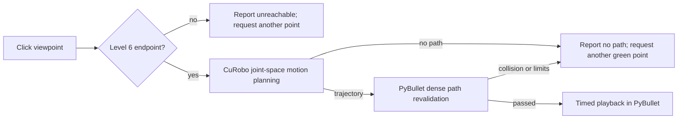

# Level 7: CuRobo Motion Planning

Level 7 lets a user select one of the Level 6 viewpoint markers in the
PyBullet window and asks CuRobo for a collision-aware joint trajectory from the
robot's current state to that viewpoint's validated joint configuration.

## Start the interactive workflow

Use a reviewed collision-aware CuRobo robot configuration. For the V2 setup:

```bash
python3 sample/pybullet_tabletop_ur5e_eye_in_hand.py \
  --plan-viewpoints \
  --ik-backend curobo \
  --curobo-robot-config artifacts/curobo/ur5e_camera_curobo_v2.yml
```

The GUI run automatically displays accepted points in green and rejected
points in red. It also adds **Move to selected viewpoint (CuRobo)** to the
PyBullet Params panel.

1. Click a displayed point in the 3D viewport.
2. Check the world-space status message. A red point reports that it is not
   reachable and asks for a green point.
3. Click **Move to selected viewpoint (CuRobo)**.
4. Keep the window open while the background CuRobo request runs.
5. The robot moves only after PyBullet accepts the returned dense trajectory.

The selected point is highlighted in yellow. Console messages mirror every
status so planning failures remain visible even when the 3D text is occluded.

## Planning pipeline



CuRobo V1 uses `MotionGen.plan_single_js`; CuRoboV2 uses
`MotionPlanner.plan_cspace`. Both enable graph-planner fallback after the first
trajectory-optimization attempt. The current joints are held fixed while the
planner runs, preventing the returned path from becoming stale before
validation.

## Second-stage PyBullet validation

CuRobo's dense trajectory is not commanded immediately. PyBullet checks:

- trajectory shape, finiteness, and expected six-joint order;
- agreement between the trajectory start and the current robot state;
- static joint limits at every checked configuration;
- robot/environment, camera/environment, camera/robot, and non-adjacent
  self-collision clearance;
- every CuRobo waypoint and additional subdivisions capped at `0.02 rad` per
  joint-space step.

The robot is restored to its entry configuration after validation. Playback
starts only when all samples pass. After playback, the final pose remains
latched until another point is commanded, a slider is moved, or `h` is pressed.

## Required collision model

Motion planning requires non-empty `collision_link_names` and
`collision_spheres` in the selected CuRobo robot YAML. Default V1 preparation
verifies that the local arm collision geometry and kinematics match the pinned
v0.7.8 package's UR5e model before mapping its reviewed spheres to the prefixed
links. A conservative sphere encloses the camera box. V2 uses its documented
RobotBuilder fitting workflow.

`python3 sample/prepare_curobo_robot.py --api-version v1 --v1-ik-only`
explicitly creates the legacy sphere-free config; Level 7 rejects it because
CuRobo could not reason about robot/world or self-collision during planning.

## CLI controls

| Option | Default | Meaning |
| --- | ---: | --- |
| `--motion-interpolation-dt` | `0.02` s | CuRobo dense output/playback timestep |
| `--motion-plan-attempts` | `5` | Maximum planning attempts for a selected point |
| `--collision-clearance` | `0.005` m | Clearance required again during PyBullet path validation |

## Safety boundary

This is simulation motion planning, not authorization to execute on hardware.
PyBullet subdivision is a dense discrete check, not exact continuous collision
detection. The simplified model still omits the Robotiq gripper, cabling,
calibration error, dynamic obstacles, controller integration, and hardware
safety limits. CuRobo's optimized velocity/acceleration/jerk constraints are
not a substitute for robot-controller validation.

Next: [Collision Safety and Limitations](Collision-Safety-and-Limitations) or
[CuRobo Setup](CuRobo-Setup).
