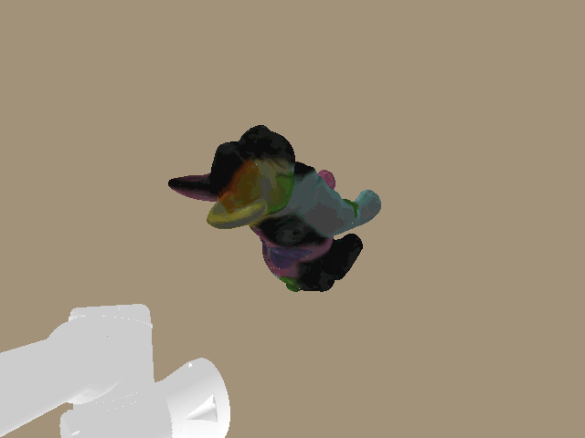

# PyBullet Environment

## Runtime model

`UR5EyeInHandPyBulletEnv` creates one `BulletClient` per environment instance:

- GUI mode uses `p.GUI`;
- headless mode uses `p.DIRECT`;
- gravity is `(0, 0, 0)`;
- the simulation timestep is `1/240 s`;
- the UR5e base is fixed;
- table, legs, workpiece, and camera proxy are static bodies;
- joints are driven kinematically with `resetJointState`.

This design provides deterministic viewpoint control. It is not intended as a
contact-dynamics, grasping, controller, or actuator benchmark.

All PyBullet operations are scoped through the environment's `BulletClient`.
Two environment instances can coexist without their bodies or joint commands
leaking between clients; this is covered by an integration test.

## World and table

World `+Z` is up. A PyBullet ground plane is loaded at `z=0`.

| Table property | Value |
| --- | --- |
| Top surface | `z = 0.75 m` |
| Top size `(x,y,z)` | `(100.0, 100.0, 0.05) m` |
| Top center | `(0.25, 0.0, 0.725) m` |
| Leg half-extents | `(0.035, 0.035, 0.350) m` |
| Leg centers | `(-0.0175, -0.13475, 0.350)` |
|  | `(-0.0175, 0.13475, 0.350)` |
|  | `(0.5175, -0.13475, 0.350)` |
|  | `(0.5175, 0.13475, 0.350)` |

The table top is rendered with RGBA `(0.80, 0.72, 0.60, 1.0)` and the legs
with `(0.55, 0.48, 0.40, 1.0)`.

The enlarged top fills the visible work area. Its four legs retain their
original positions, so enlarging the background surface does not move any
other part of the workcell. Each leg extends from the floor to the underside
of the tabletop at `z = 0.70 m`; no leg geometry intersects the top surface.

The plane is part of the rendered world but is deliberately not included in
the reachability clearance query. The elevated table is included.

## UR5e model

The source model is:

```text
assets/steve_description/urdf/steve_ur5e.urdf
```

At startup the script creates a reduced runtime URDF under
`artifacts/pybullet/`. It:

- retains the UR5e base, six arm links, wrist fixed frames, flange, and `tool0`;
- removes the source gripper/end-effector assembly and unrelated elements;
- rewrites retained mesh references to absolute paths;
- preserves the source visual and collision geometry for retained links.

The robot base pose is:

```text
position:    (0.0, 0.0, 0.75) m
orientation: (0.0, 0.0, 0.0, 1.0) XYZW
```

The camera parent is `ur5e_wrist_3_link`. PyBullet IK targets `ur5e_tool0`.

### Joint order and home state

| Joint | Home position |
| --- | ---: |
| `ur5e_shoulder_pan_joint` | `0.0 rad` |
| `ur5e_shoulder_lift_joint` | `-1.57 rad` |
| `ur5e_elbow_joint` | `1.57 rad` |
| `ur5e_wrist_1_joint` | `-1.57 rad` |
| `ur5e_wrist_2_joint` | `-1.57 rad` |
| `ur5e_wrist_3_joint` | `0.0 rad` |

The runtime model reports `[-2*pi, 2*pi]` for all joints except the elbow,
which reports `[-pi, pi]`. A malformed URDF range is replaced by
`[-2*pi, 2*pi]` during loading.

Joint commands must contain exactly six finite values. Interactive commands
use a blend factor of `0.18` per update; direct endpoint application and tests
can use a blend of `1.0`.

## Workpiece

Bundled source meshes are selected with `--object NAME`. The default is:

```text
tasks/3d_models/obj_000020.ply
```

If the flag is omitted, `obj_000020` is used for every IK backend and capture
configuration. Names containing spaces must be quoted; the `.ply` suffix is
optional. `--workpiece-ply PATH` can instead select an external mesh.

The default mesh is an ASCII PLY with 130,232 vertices and 260,460 faces. The
converter also accepts binary little- and big-endian PLY geometry. The default
scale is `0.001`, treating source coordinates as millimetres. The runtime converter:

1. reads vertex XYZ positions, polygon indices, and optional RGB colours;
2. converts the requested units to metres;
3. centers the mesh in X and Y;
4. moves its minimum Z to zero;
5. optionally bakes a Z-axis rotation;
6. triangulates non-triangular faces;
7. writes a runtime OBJ under `artifacts/pybullet/`;
8. when RGB is present, averages colour per dense triangle and writes a
   quantized PNG palette plus OBJ UV coordinates.

PyBullet does not consume PLY colours or the common OBJ vertex-colour
extension. The generated UV/palette representation preserves the scanned
colours in both the GUI and wrist-camera renderer. Colourless PLY files retain
the neutral blue-grey fallback. Source normals and other PLY properties are
not transferred.



Run the colour-preserving default workpiece in the GUI with:

```bash
python3 sample/pybullet_tabletop_ur5e_eye_in_hand.py --object obj_000020
```

The workpiece base is `(0.45, -0.10, 0.75) m`. With the default input, its
observed extent is approximately:

```text
(0.191364, 0.108374, 0.219005) m
```

The planning target is the center of the PyBullet collision AABB, not the
source mesh centroid. In the validated fixture it was approximately
`(0.45, -0.10, 0.859503) m`.

The workpiece uses its source RGB colours when present. Otherwise it is
rendered with RGBA `(0.62, 0.70, 0.78, 1.0)`. Its specular colour is
`(0.15, 0.15, 0.15)`.

## Capability-map overlay

GUI mode displays the UR5e capability map by default. The first launch samples
100,000 arm configurations with PyBullet forward kinematics and Jacobians,
writes `output/ur5e_capability_map.npz`, and displays it. Later launches load
the cached map. `sample/generate_capability_map.py` can also build the cache
headlessly in advance.

The map contains all three capability components:

| Display | Meaning |
| --- | --- |
| Blue to yellow workspace points | Low to high Yoshikawa manipulability |
| Small to large workspace points | Low to high reachability (relative joint-sample count per 5 cm voxel) |
| Magenta/pink tabletop points | Inverse-reachability candidates for robot-base placement |
| Saturated magenta to pale pink points | Low to high manipulability at the corresponding inverse pose |
| Small to large placeability points | Few to many inverse-pose samples in that planar base voxel |

Manipulability colours use the 5th and 95th score percentiles as display limits,
so a small number of outliers cannot flatten the colour range. Reachability and
placeability sizes are normalized independently to the most populated voxel.
These are relative scores, not success probabilities.

The workspace cloud is expressed in the robot-base frame and shifted to the
simulator's base pose at table height. For the placeability layer, the desired
TCP is placed at the workpiece center with the home TCP orientation. Only
candidate bases within 5 cm of table height and within 10 degrees of upright
are projected onto 5 cm tabletop voxels.

Use `--no-capability-map` to hide the overlay. `--capability-map PATH` selects
another cache, and `--capability-samples N` controls sampling only when that
cache does not yet exist. Headless mode neither generates nor renders the
default GUI overlay.

## Wrist camera

The simulated sensor is a monocular RGB wrist camera. It does not expose depth
or segmentation images.

| Camera property | Value |
| --- | ---: |
| Resolution | `640 x 480` |
| Focal length | `2.0 mm` |
| Vertical aperture | `2.453 mm` |
| Vertical FOV | `63.037415 degrees` |
| Horizontal FOV | `78.543444 degrees` |
| Near plane | `0.02 m` |
| Far plane | `3.0 m` |

The collision/visual housing is a box with half-extents
`(0.021, 0.021, 0.0115) m`, or full dimensions `42 x 42 x 23 mm`. Its center is
11.5 mm behind the optical center along optical `-Z`.

The body is attached to `ur5e_wrist_3_link` with a fixed constraint and is also
explicitly synchronized after every kinematic joint reset.

See [Frames and Transforms](Frames-and-Transforms) for the calibrated extrinsic.

### Rendering outputs

`capture_wrist_camera()` returns one `uint8` RGB image through
`CameraCapture.rgb`. PyBullet's fixed rendering API internally returns extra
depth and segmentation buffers, but this environment immediately discards
them and does not expose them as camera outputs. Saving a frame writes RGB
only. The simulator does not model distortion, sensor noise, exposure, or
rolling shutter.

In GUI mode, only PyBullet's RGB buffer preview is enabled; its generic depth
and segmentation preview panes are explicitly disabled.

GUI mode uses `ER_BULLET_HARDWARE_OPENGL`; headless mode uses
`ER_TINY_RENDERER`. Wrist-camera frames use soft, mostly ambient illumination
with specular highlights and hard shadows disabled, keeping the tabletop
brightness even across the image.

The interactive GUI viewport is configured separately because PyBullet does
not share its lighting controls with `getCameraImage()`. GUI shadows and the
associated point-light specular shader are disabled, the GUI light is placed
straight overhead, and the table material has zero specular reflectance.

## GUI controls

- Six sliders command the arm joints.
- **Save wrist-camera image...** in the Params panel opens a save dialog for
  choosing the current RGB frame's local directory and filename.
- After `--plan-viewpoints`, click a rendered point and use **Move to selected
  viewpoint (CuRobo)**. Red points report their Level 6 rejection; green points
  move only after CuRobo planning and dense PyBullet path revalidation.
- `h` returns to home and holds until a slider moves.
- `c` saves a timestamped RGB PNG.
- `q` exits.
- A Matplotlib camera preview opens by default at `5 Hz`; use
  `--no-camera-feed` to disable it.

## Headless and planning behavior

| Invocation | Behavior |
| --- | --- |
| `--headless` | Resets home, simulates 60 steps, saves one RGB frame, exits |
| `--headless --plan-viewpoints` | Runs reachability and writes JSON; does not also save a snapshot |
| `capture_four_views.py --headless` | Runs four-view reachability/motion without playback delays and writes four timestamped RGB/JSON records plus a manifest |
| `--plan-viewpoints` in GUI mode | Runs reachability, draws selectable points, and opens interactive controls |
| `--visualize-viewpoints` in GUI mode | Explicitly requests accepted points green, rejected points red, target center blue (GUI planning already displays them) |
| `--visualize-viewpoints --headless` | No debug-point visualization |
| GUI mode (default) | Loads or generates the capability map and displays workspace and base-placeability voxels |
| `--no-capability-map` | Runs GUI mode without the capability-map overlay |

The default image path is `output/pybullet/wrist_camera_latest.png`.
Four-view capture uses `output/pybullet/four_views/` by default and embeds the
same per-capture metadata in each PNG as well as a JSON sidecar. See
[Four-View Capture](Four-View-Capture).

## Docker environment

The default Dockerfile is based on Ubuntu 24.04 and includes PyBullet, OpenCV,
PCL, Eigen, Pillow, Matplotlib, NumPy, SciPy, scikit-image, scikit-learn,
compiler/debugging tools, Mesa, and X11 libraries.

```bash
docker build -t findvp-pybullet-env:24.04 .
```

For GUI use:

```bash
xhost +SI:localuser:root

docker run -it --rm \
  --name findvp-pybullet \
  --network=host \
  -e DISPLAY=$DISPLAY \
  -v /tmp/.X11-unix:/tmp/.X11-unix \
  -v "$PWD":/workspace \
  findvp-pybullet-env:24.04
```

`--gpus all` is not needed for the PyBullet/TinyRenderer workflow. The default
Dockerfile does not install CuRobo, so `--plan-viewpoints` with the default
`--ik-backend auto` policy reports V1 runtime unavailability and selects
PyBullet. Pass `--ik-backend pybullet` to skip that probe. GPU IK uses the
separate CuRobo V1 container with `--gpus all`. For a GUI in that container,
also use `--ipc=host`, mount `/tmp/.X11-unix`, pass `DISPLAY`, and enable
`NVIDIA_DRIVER_CAPABILITIES=compute,utility,graphics,display`; see
[CuRobo Setup](CuRobo-Setup) for the complete launch command.

PyBullet is currently installed from PyPI without a version pin, so numerical
behavior should be regression-tested when rebuilding the image.

Next: [Frames and Transforms](Frames-and-Transforms),
[Collision Safety and Limitations](Collision-Safety-and-Limitations), or
[CLI Reference](CLI-Reference).
