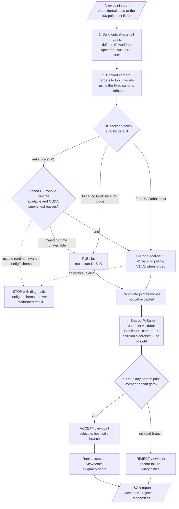

# Viewpoint Planning, Capture, and Perception

This wiki documents the tabletop UR5e eye-in-hand workflow from viewpoint
generation and reachability through collision-checked motion, RGB capture,
DINOv3 correspondence, four-view ranking, and target-guided active perception.
Level 6 removes camera
viewpoints when a finite IK search cannot find a branch that passes the shared
PyBullet endpoint validator; Level 7 plans and revalidates motion to accepted
views. The newer perception workflow captures four reproducible hemisphere
views and ranks them against a target image. The active workflow recursively
refines an equal-area spherical triangle while preserving the global score
incumbent, then probes closer/farther camera radii along the best observation
ray.

> [!IMPORTANT]
> The 100-point Fibonacci shell is a deterministic Level 6 test fixture. It is
> not the required production input format. The production-shaped API accepts
> one externally generated viewpoint at a time.

## What Level 6 guarantees

An accepted viewpoint has at least one six-joint UR5e configuration that passed:

- joint-order, finite-value, and joint-limit checks;
- optical-camera forward-kinematics position and orientation tolerances;
- robot/environment, camera/environment, camera/robot, and self-collision
  clearance checks;
- the camera-to-object-center line-of-sight check, unless disabled.

Acceptance certifies a simulated endpoint for the configured, simplified
model. It does not certify a collision-free trajectory, robot dynamics, or
hardware safety.

A rejected viewpoint is reported as `no_valid_solution_found`. That means the
configured finite search found no branch passing every gate. It is deliberately
not described as proof that no mathematical IK solution exists.

## Architecture at a glance



CuRobo is a candidate generator. PyBullet remains the authoritative endpoint
validator for both backends. Automatic fallback is deliberately limited to
typed V1 runtime/package/driver/Torch/CUDA/GPU unavailability. Configuration,
schema, solver, and result-contract errors are visible hard failures.

The filter captures the current joints and restores them in a `finally` block
after success or error. It returns a selected joint vector without permanently
moving the simulated robot.

## Capture and perception workflow

```mermaid
flowchart LR
    sample["Four equal-solid-angle<br/>hemisphere representatives"]
    ik["CuRobo or PyBullet<br/>IK candidate generation"]
    endpoint["PyBullet endpoint<br/>validation"]
    motion["CuRobo MotionGen or<br/>validated joint-linear path"]
    trajectory["Dense PyBullet<br/>trajectory revalidation"]
    capture["Timestamped RGB +<br/>pose metadata"]
    segment["SAM automatic<br/>object proposal"]
    features["DINOv3 patch<br/>descriptors"]
    geometry["Mutual nearest matches +<br/>fundamental-matrix RANSAC"]
    score["DINO + geometry +<br/>local ZNCC score"]
    rank[Rank four views]

    sample --> ik --> endpoint --> motion --> trajectory --> capture
    capture --> segment --> features --> geometry --> score --> rank
```



`sample/capture_four_views.py` owns capture and safety. The ranking stage is in
`notebooks/dinov3_feature_matching.ipynb`; capture does not silently run a
learned model or choose a best image. See [Four-View Capture](Four-View-Capture)
and [DINOv3 Matching and Ranking](DINOv3-Matching-and-Ranking).

`sample/active_perception_triangles.py` combines the same validated motion and
ranking components into an online search. Supplying `--target-image` enables
angular refinement and final radial fine alignment; `--debug` only adds
diagnostic visualizations. Successful runs also emit timestamped and latest
evaluation reports plus an append-only trial CSV for view count, target/travel
distance, execution time, PSNR, and SSIM.

## Current validation snapshot

The deterministic PyBullet fixture was last validated with the world-up
roll-0 default on 2026-07-23:

| Result | Value |
| --- | ---: |
| Sampled viewpoints | 100 |
| Accepted | 52 |
| Rejected | 48 |
| Highest-ranked viewpoint | 23 |
| Selected roll | 0 degrees |
| Quality score | 0.671 |
| Python tests | 81 passing |

The CuRobo V1 path was separately validated on the RTX 3060/R535 system. The
world-up default produced 64 validated endpoints in about `10.85 s` on
2026-07-23. The earlier explicit four-roll configuration produced 88 endpoints
in about `10.05 s`, but permits rotated images. This is execution evidence, not
a golden regression count.

Runtime can vary by machine. The accepted set is intended to be deterministic
for a fixed code, model, PyBullet, and numerical environment.

## Wiki map

- [Branch and Code Map](Branch-and-Code-Map) — branch scope, source files, and dependency structure.
- [PyBullet Environment](PyBullet-Environment) — robot, table, workpiece, camera, controls, and modes.
- [Level 6 Reachability Pipeline](Level-6-Reachability-Pipeline) — the complete filtering and ranking algorithm.
- [Level 7 CuRobo Motion Planning](Level-7-CuRobo-Motion-Planning) — select a validated point and plan/revalidate a simulated trajectory.
- [Four-View Capture](Four-View-Capture) — generate, reach, move to, and record four reproducible hemisphere views.
- [DINOv3 Matching and Ranking](DINOv3-Matching-and-Ranking) — automatic RGB object masks, verified correspondence, scoring, and ranking.
- [Using External Viewpoints](Using-External-Viewpoints) — production-shaped sequential integration.
- [Viewpoint Sampling](Viewpoint-Sampling) — the deterministic 100-point fixture and framing rule.
- [IK Backends](IK-Backends) — PyBullet multi-start IK and the shared backend contract.
- [CuRobo Setup](CuRobo-Setup) — V1 for the RTX 3060/R535 machine and the separate V2 path.
- [Frames and Transforms](Frames-and-Transforms) — frame notation, camera convention, and target packing.
- [Collision Safety and Limitations](Collision-Safety-and-Limitations) — exact gates and what the result cannot prove.
- [CLI Reference](CLI-Reference) — commands, defaults, and option behavior.
- [JSON Report Reference](JSON-Report-Reference) — report schema and interpretation.
- [Testing and Validation](Testing-and-Validation) — tests, regression checks, and unvalidated areas.
- [Troubleshooting](Troubleshooting) — common PyBullet, CuRobo, Docker, and model problems.

## Quick start

Run the default automatic fixture from the repository root. It prefers pinned
CuRobo V1 and falls back to PyBullet if that runtime is unavailable:

```bash
python3 sample/pybullet_tabletop_ur5e_eye_in_hand.py \
  --headless \
  --plan-viewpoints
```

Use `--ik-backend pybullet` to force CPU IK without a CuRobo probe, or
`--ik-backend curobo --curobo-robot-config PATH` to require CuRobo without
fallback.

The default report is written to:

```text
output/pybullet/reachable_viewpoints.json
```

Run the test suite with:

```bash
python3 -m unittest discover -s tests -v
```

Capture the four analytic hemisphere views:

```bash
python3 sample/capture_four_views.py --headless
```

Then install the optional perception dependencies and run the notebook to
compare images or rank the newest complete four-view run:

```bash
python3 -m pip install -r requirements-dinov3.txt
jupyter lab notebooks/dinov3_feature_matching.ipynb
```
